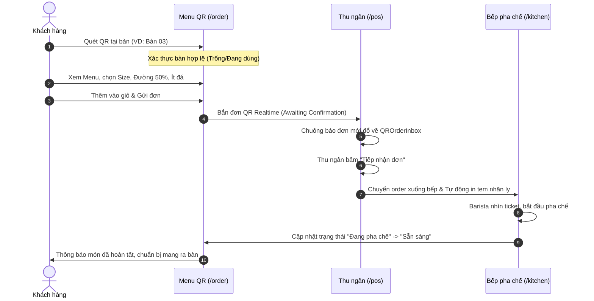
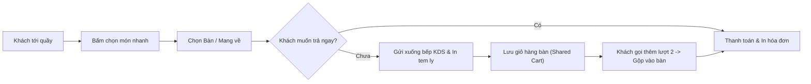

# H2 MilkTea POS & QR Ordering System - PRODUCT SPECIFICATION

## 1. Tổng quan Sản phẩm (Product Overview)
**H2 MilkTea** là nền tảng quản lý bán hàng (POS), điều phối pha chế (KDS), quản trị doanh thu - kho bãi, và hệ thống tự phục vụ gọi món qua mã QR tại bàn (Customer QR Self-Ordering) dành cho chuỗi quán trà sữa & cà phê tại Việt Nam.

Hệ thống được thiết kế theo kiến trúc Web-first hiện đại (Next.js 15, React 19, Supabase Realtime, Tailwind CSS) với mục tiêu:
1. **Tối ưu tốc độ phục vụ tại quầy**: Giảm thời gian thao tác order và thanh toán xuống dưới 15 giây/đơn.
2. **Khách hàng gọi món không chạm**: Khách ngồi tại bàn quét mã QR, gọi món và theo dõi tiến độ pha chế trực tiếp trên điện thoại mà không cần cài đặt ứng dụng.
3. **Đồng bộ thời gian thực (Zero-Lag Realtime)**: Dữ liệu giỏ hàng của bàn, thông báo đơn mới, trạng thái ly nước ở bếp được truyền nhận tức thì giữa Khách hàng - Thu ngân - Barista pha chế.

---

## 2. Nhóm người dùng mục tiêu (Personas) & Bối cảnh sử dụng

| Persona | Thiết bị sử dụng | Môi trường / Bối cảnh | Nhu cầu then chốt | Thách thức UX lớn nhất |
| :--- | :--- | :--- | :--- | :--- |
| **Khách ngồi tại bàn** (Customer) | Smartphone cá nhân (iOS/Android, 375px - 430px) | Quán đông đúc, mạng 4G/Wifi quán đôi khi chập chờn, cầm máy bằng một tay | Xem menu trực quan, chọn size/đường/đá nhanh, kiểm soát số tiền, gọi phục vụ dễ dàng | Vùng chạm nhỏ, modal/drawer che khuất nhau, mất đơn khi đóng tab |
| **Nhân viên Thu ngân** (Cashier) | Máy POS cảm ứng (1366x768 / 1920x1080) hoặc iPad ngang (1024px) | Áp lực giờ cao điểm (Peak hours), xếp hàng dài, vừa tính tiền vừa tiếp nhận đơn QR | Bấm món cực nhanh bằng phím tắt/màn hình chạm, không bao giờ bị nhảy bố cục hay đơ ứng dụng | Hộp thư QR làm lệch vị trí bấm món, nút Trợ lý AI che nút Thanh toán, nút Xóa giỏ quá sát thao tác chính |
| **Nhân viên Pha chế / Barista** (Kitchen Staff) | Màn hình KDS treo tường (1920x1080 hoặc Tablet 10-12 inch) | Tay ướt/đeo găng tay, đứng cách màn hình từ 1.0 – 2.0 mét | Đọc nhanh số bàn, tên món, định lượng đường/đá mà không cần lại gần chạm màn hình | Cỡ chữ tên món và ghi chú quá nhỏ (12-14px), màu sắc ghi chú mờ, khó phân biệt ưu tiên |
| **Chủ quán / Quản lý** (Manager) | Laptop / Máy tính bảng / Điện thoại | Bất kỳ lúc nào, cần nắm bắt doanh thu, kho nguyên liệu, hủy đơn bất thường | Báo cáo rõ ràng, bảng biểu không bị xô lệch tiếng Việt, kiểm soát ca làm việc minh bạch | Bảng biểu bị tràn chữ, thiếu khoảng đệm cuộn ngang |

---

## 3. Luồng nghiệp vụ cốt lõi (Core User Journeys)

### Luồng 1: Khách quét QR gọi món tại bàn

### Luồng 2: Thu ngân bán tại quầy & Xử lý đơn phát sinh

---

## 4. Các nguyên tắc sản phẩm không thể thỏa hiệp (Non-Negotiables)
1. **Độ tin cậy của Đơn hàng (Order Integrity)**:
   - Một khi khách đã gửi đơn thành công, token trạng thái phải tồn tại bền vững trên `localStorage` và đồng bộ qua server. Đóng tab, mất mạng hay load lại trang tuyệt đối không được làm mất tiến trình đơn.
2. **Không che khuất luồng bán hàng (Zero Obstruction Policy)**:
   - Không bất kỳ thành phần nổi (FAB Trợ lý AI, banner popup, alert box) nào được phép che phủ hoặc làm giật layout các nút hành động cốt lõi của POS ("Thanh toán", "Gửi bếp", "Chọn bàn").
3. **Chuẩn công thái học thực chiến (Ergonomic Compliance)**:
   - Giao diện khách hàng: Tối ưu vùng ngón cái (Thumb-zone) trên màn hình dọc 375px - 430px.
   - Giao diện KDS: Đọc rõ thông tin quan trọng ở cự ly 1.5 mét không cần lại gần.
