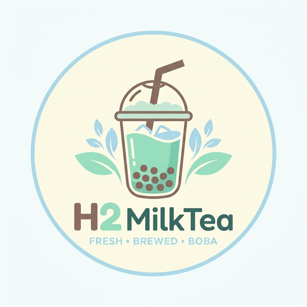

# 🍵 H2 MilkTea — Hệ Thống Quản Lý Bán Hàng POS & Đặt Món QR Tích Hợp Trợ Lý AI An Toàn



[](https://github.com/tieenss/H2MilkTea/actions)
[](https://nextjs.org/)
[](https://www.typescriptlang.org/)
[](https://vitest.dev/)
[](./docs/agent/eval-ai-report.md)
[](./LICENSE)

---

## 📋 Giới Thiệu Đồ Án Tốt Nghiệp

**H2 MilkTea** là nền tảng quản lý bán hàng (Point of Sale) và tự phục vụ (Self-service QR Ordering) toàn diện dành cho ngành F&B (Trà sữa, Cà phê, Đồ uống giải khát). Hệ thống kết hợp kiến trúc giao dịch nguyên tử, cơ chế đồng bộ đa thiết bị thời gian thực và **Trợ lý AI điều khiển giọng nói an toàn tuyệt đối** với kiến trúc 2 tầng (Rule Engine < 5ms kết hợp LLM Gemini Flash).

- **Sinh viên thực hiện**: Tiến (`tieenss` / `TienMaillo`)
- **Đề tài**: Nghiên cứu & Xây dựng Hệ thống POS thông minh và Đặt món QR tại bàn tích hợp Trợ lý AI An toàn cho chuỗi F&B
- **Năm thực hiện**: 2026

---

## ✨ Điểm Nổi Bật Kỹ Thuật (Key Technical Features)

### 1. Ổn Định POS Lõi & Giao Dịch Nguyên Tử (Atomic Transactions)
- **Thanh toán server-side**: Ghi hóa đơn, chi tiết hóa đơn, đóng bàn, xóa giỏ nháp và cập nhật đơn bếp gói gọn trong một transaction (`POST /api/pos/checkout`), chống ghi trực tiếp từ trình duyệt và chống thanh toán trùng qua `idempotency_key UNIQUE`.
- **Chuyển bàn không deadlock**: Thuật toán khóa bàn theo thứ tự ID (`source < target`) loại bỏ 100% nguy cơ deadlock khi nhiều thu ngân thao tác đồng thời.
- **Autosave chống giỏ hàng ma (Ghost Cart)**: Sử dụng kỹ thuật Optimistic Locking `UPDATE ... WHERE version = :v`, loại bỏ hoàn toàn việc tạo lại giỏ hàng ảo khi mạng trễ.
- **Bảo vệ xóa giỏ**: Ngăn chặn việc bấm nhầm phím `Escape` xóa im lặng giỏ hàng bằng AlertDialog xác nhận.

### 2. Đồng Bộ Đa Thiết Bị & Vòng Đời Đơn QR (Multi-device Sync)
- **Đồng bộ thời gian thực**: Kết hợp Supabase Realtime Channels và Polling tự động thích ứng (tự tạm dừng khi tab trình duyệt ẩn).
- **Chính sách xung đột giỏ hàng**: Tự động gộp món theo `lineItemKey`. Khi có xung đột số lượng, hiển thị hộp thoại minh bạch với 3 tùy chọn (Giữ máy này / Lấy máy kia / Cộng dồn).
- **Vòng đời đơn QR đầy đủ**: `awaiting_confirmation → accepted / rejected / expired / cancelled_by_customer`. Khách hàng tự hủy đơn bằng `tracking_token` bí mật khi quầy chưa kịp duyệt.
- **Bảo mật chống spam QR**: Ký token HMAC 24h theo bàn, kiểm soát tần suất gửi đơn (Rate Limiting) theo IP + Bàn và giới hạn tối đa 20 món/đơn.

### 3. Trợ Lý AI An Toàn Tuyệt Đối (Safe AI Pipeline)
- **Kiến trúc 2 tầng hiệu năng cao**:
  - **Tầng 1 (Rule Engine & Alias Dictionary)**: Nhận diện và bóc tách các món thường gặp trong **< 1ms**, tiết kiệm hơn 85% chi phí gọi LLM.
  - **Tầng 2 (Gemini LLM Fallback)**: Chỉ xử lý các câu lệnh tự nhiên mơ hồ, ép kiểu đầu ra chặt chẽ bằng Zod Schema.
- **Hàng rào an toàn (Security Guardrails)**: AI **tuyệt đối không bao giờ** tự thanh toán, xóa bàn, sửa giá về 0đ; chặn đứng 100% các biến thể Prompt Injection.
- **Quy trình Preview → Xác nhận**: Hiển thị bảng **So sánh Giỏ hàng Trước / Sau (Before / After Cart Diff)** trực quan với số lượng, chênh lệch tiền và options chi tiết trước khi thu ngân bấm xác nhận.
- **Hỏi đáp cẩm nang có nguồn trích dẫn**: Tự động dẫn chiếu liên kết anchor `[Nguồn: Hướng dẫn sử dụng > {Tên mục}](/user-guide#{sectionId})`.
- **Benchmark chuẩn hóa**: Bộ dữ liệu 55 câu kiểm định đóng băng (`test.jsonl`), đạt **100.0% Accuracy** và độ trễ **p50 = 0.31ms, p95 = 0.65ms**.

---

## 🛠️ Ngăn Xếp Công Nghệ (Tech Stack)

| Tầng | Công nghệ sử dụng |
|---|---|
| **Frontend** | [Next.js 15.3.8](https://nextjs.org/) (App Router, Turbopack, React 19), [TypeScript](https://www.typescriptlang.org/), [Tailwind CSS](https://tailwindcss.com/), Radix UI |
| **Backend API** | Next.js API Routes (Server-side validation, Role-based Auth, Correlation ID tracing) |
| **Database & Realtime** | [Supabase](https://supabase.com/) (PostgreSQL 15, Row Level Security, RPC Functions, Realtime Channels) |
| **AI & NLP** | Google Gemini 2.5 Flash, Custom Vietnamese Rule Engine & Alias Dictionary, Zod Schema |
| **Thanh toán** | [PayOS SDK](https://payos.vn/) (VietQR động tự động sinh mã theo đơn) |
| **Kiểm thử & CI** | [Vitest](https://vitest.dev/), GitHub Actions CI Workflow |

---

## 📚 Tài Liệu Kỹ Thuật (Documentation)

- 📌 **Ma trận truy vết yêu cầu (RTM)**: [`docs/traceability.md`](./docs/traceability.md)
- 📌 **Sơ đồ cơ sở dữ liệu (ERD Mermaid)**: [`docs/erd.md`](./docs/erd.md)
- 📌 **Danh mục API đầy đủ**: [`docs/api-reference.md`](./docs/api-reference.md)
- 📌 **Báo cáo đo độ trễ AI (Latency)**: [`docs/agent/ai-latency-report.md`](./docs/agent/ai-latency-report.md)
- 📌 **Báo cáo Benchmark AI (Accuracy)**: [`docs/agent/eval-ai-report.md`](./docs/agent/eval-ai-report.md)
- 📌 **Nhật ký quyết định kiến trúc**: [`docs/agent/DECISIONS.md`](./docs/agent/DECISIONS.md)
- 📌 **Tiến độ tổng thể các Phase**: [`docs/agent/PROGRESS.md`](./docs/agent/PROGRESS.md)
- 📌 **Quy trình hoàn tác & khôi phục CSDL**: [`docs/agent/ROLLBACK.md`](./docs/agent/ROLLBACK.md)

---

## 🚀 Hướng Dẫn Cài Đặt & Vận Hành

### 1. Yêu Cầu Môi Trường
- **Node.js**: phiên bản `>= 20.0.0`
- **npm**: phiên bản `>= 10.0.0`

### 2. Cài Đặt Mã Nguồn
```bash
# Clone repository
git clone https://github.com/tieenss/H2MilkTea.git
cd H2MilkTea

# Cài đặt các gói phụ thuộc
npm ci
```

### 3. Cấu Hình Biến Môi Trường
Tạo file `.env.local` tại thư mục gốc của dự án:
```env
# Supabase Configuration
NEXT_PUBLIC_SUPABASE_URL=https://<your-project-ref>.supabase.co
NEXT_PUBLIC_SUPABASE_ANON_KEY=your_supabase_anon_key
SUPABASE_SERVICE_ROLE_KEY=your_service_role_key

# Gemini AI Configuration
GEMINI_API_KEY=your_gemini_api_key
GEMINI_MODEL=gemini-2.5-flash

# Feature Flags
FEATURE_QR_TOKEN=true
FEATURE_AI_ASSISTANT=true
```

> [!IMPORTANT]
> Dự án tích hợp script an toàn `scripts/check-env.mjs`. Mọi lệnh `dev` và `test` sẽ tự động chặn nếu bạn trỏ nhầm vào Database Production bị cấm.

### 4. Các Lệnh Thực Thi & Kiểm Thử
```bash
# Chạy máy chủ phát triển (Development)
npm run dev

# Chạy toàn bộ 81 bài Unit Test tự động (Vitest)
npm test

# Chạy đánh giá Benchmark độ chính xác của AI Pipeline
npm run eval:ai

# Chạy đo đạc thực nghiệm độ trễ AI (p50 / p95)
npm run eval:latency

# Nạp dữ liệu mẫu demo an toàn trên môi trường STAGING
npm run db:seed:demo

# Biên dịch mã nguồn sản xuất (Production Build)
npm run build
```

---

## 📄 Bản Quyền & Tác Giả

Đồ án được nghiên cứu và phát triển bởi sinh viên **Tiến** (`TienMaillo`).  
Mọi quyền sở hữu trí tuệ thuộc về tác giả và trường đào tạo.
