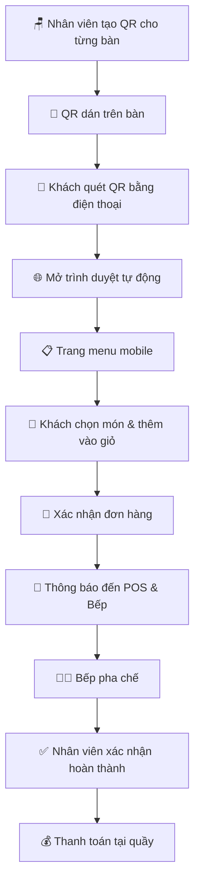
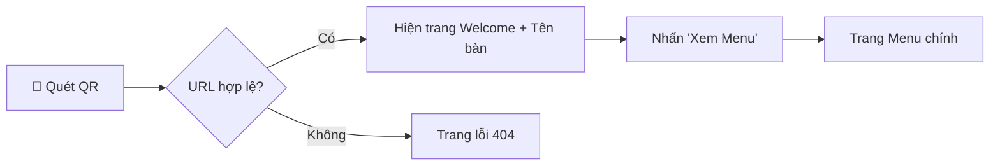
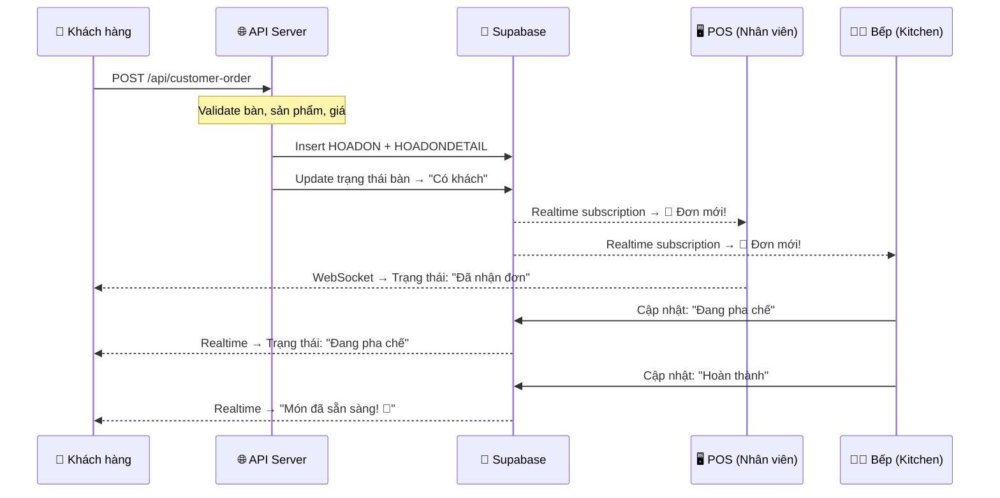
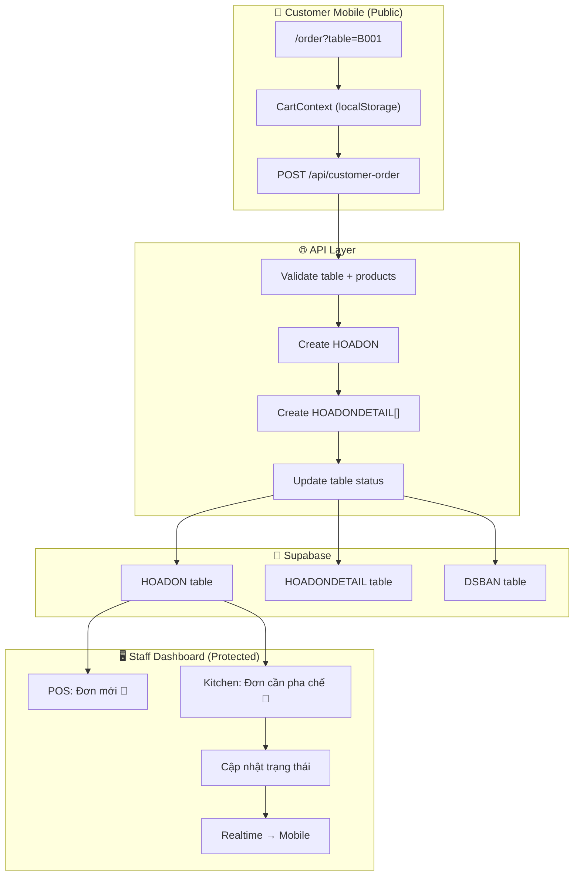
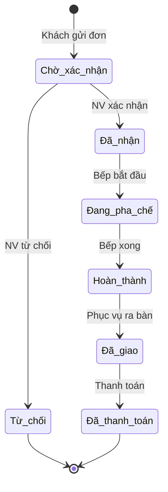

# 🎯 Kịch Bản Tính Năng: Khách Hàng Quét QR Đặt Món

## 📋 Phân Tích Hiện Trạng

### Webapp hiện tại CHƯA có tính năng mobile cho khách hàng
- Webapp hiện tại là **hệ thống POS quản lý** (dành cho nhân viên/quản lý)
- Tất cả route đều yêu cầu **đăng nhập** (middleware bảo vệ)
- Giao diện desktop-first với sidebar + header (không tối ưu cho khách hàng mobile)
- Chưa có route `/order` hay `/customer` dành cho khách hàng tự phục vụ

### Dữ liệu sẵn có để tích hợp
| Dữ liệu | File | Mô tả |
|----------|------|--------|
| Menu sản phẩm | [DMHH.json](file:///d:/Documents/H2MilkTea/src/data/DMHH.json) | 53 sản phẩm, 10 danh mục |
| Danh sách bàn | [DSBAN.json](file:///d:/Documents/H2MilkTea/src/data/DSBAN.json) | 24 bàn (nhiều khu vực) |
| Hóa đơn | [HOADON.json](file:///d:/Documents/H2MilkTea/src/data/HOADON.json) | Cấu trúc hóa đơn |
| Chi tiết HD | [HOADONDETAIL.json](file:///d:/Documents/H2MilkTea/src/data/HOADONDETAIL.json) | Chi tiết từng món |

---

## 🔄 Kịch Bản Luồng Hoạt Động (End-to-End)

### Tổng quan luồng



---

## 📐 Chi Tiết Từng Bước

### Bước 1: Tạo & Quản lý QR Code (Phía Admin/Quản lý)

> [!IMPORTANT]
> Mỗi bàn có một QR Code riêng, chứa URL dẫn đến trang order kèm mã bàn

**URL format:**
```
https://h2milktea.vercel.app/order?table={IDBAN}
```

**Ví dụ thực tế với dữ liệu hiện tại:**
| Bàn | IDBAN | URL QR |
|-----|-------|--------|
| Bàn 01 | B001 | `/order?table=B001` |
| Bàn 03 | BAN001 | `/order?table=BAN001` |
| Sofa 01 (Tầng 2) | SOFA01 | `/order?table=SOFA01` |
| Phòng VIP 01 | PHONGVIP01 | `/order?table=PHONGVIP01` |
| Khách mua về | Khách mua về | `/order?table=takeaway` |

**Tính năng cần build:**
- Nút "Tạo QR" trên trang `/tables` → generate QR code cho mỗi bàn
- Tùy chọn tải QR về dạng hình (PNG) hoặc in trực tiếp
- QR kèm logo H2 MilkTea và tên bàn bên dưới

---

### Bước 2: Khách Quét QR & Truy Cập (Phía Khách Hàng Mobile)



**Màn hình Welcome (Landing):**
- Logo H2 MilkTea
- Hiển thị: _"Chào mừng đến H2 MilkTea! Bạn đang ngồi tại **Bàn 03**"_
- Nút CTA: **"Xem Menu & Đặt Món"**
- Không yêu cầu đăng nhập/đăng ký

> [!NOTE]
> Route `/order` là route **công khai** (public), không cần authToken. Cần cập nhật middleware để cho phép truy cập.

---

### Bước 3: Giao Diện Menu Mobile (Core Feature)

**3a. Cấu trúc trang:**

```
┌─────────────────────────┐
│  🏠 H2 MilkTea          │
│  📍 Bàn 03              │
├─────────────────────────┤
│  🔍 Tìm kiếm món...     │
├─────────────────────────┤
│ [Tất cả] [Cà phê]      │
│ [Trà sữa] [Trà] [Ép]   │
│ [Sinh tố] [Ăn vặt] ... │
├─────────────────────────┤
│  ┌───────┬───────┐      │
│  │ 🖼️    │ 🖼️    │      │
│  │Cafe   │Bạc    │      │
│  │đen đá │xỉu    │      │
│  │25.000đ│30.000đ│      │
│  │ [+]   │ [+]   │      │
│  └───────┴───────┘      │
│  ┌───────┬───────┐      │
│  │ 🖼️    │ 🖼️    │      │
│  │Cafe   │Cafe   │      │
│  │sữa đá │muối   │      │
│  │28.000đ│35.000đ│      │
│  │ [+]   │ [+]   │      │
│  └───────┴───────┘      │
├─────────────────────────┤
│  🛒 Giỏ hàng (3)  150K │
│  [    Xem giỏ hàng    ] │
└─────────────────────────┘
```

**3b. Danh mục sản phẩm (từ dữ liệu thực):**

| Danh mục | Số SP | Khoảng giá |
|----------|-------|------------|
| Cà phê | 12 | 25.000đ - 45.000đ |
| Trà sữa | 18 | 28.000đ - 45.000đ |
| Trà | 4 | 20.000đ - 45.000đ |
| Nước ép | 4 | 20.000đ - 30.000đ |
| Sinh tố | 3 | 35.000đ - 40.000đ |
| Sữa chua | 3 | 28.000đ - 40.000đ |
| Đá xay | 1 | 35.000đ |
| Đồ uống nóng | 1 | 35.000đ |
| Đồ uống lạnh | 1 | 35.000đ |
| Ăn vặt | 2 | 15.000đ - 35.000đ |
| Bánh ngọt | 2 | 25.000đ - 45.000đ |

**3c. Chi tiết sản phẩm (khi tap vào):**

```
┌─────────────────────────┐
│         [X]             │
│  ┌─────────────────┐    │
│  │                 │    │
│  │    🖼️ Ảnh SP    │    │
│  │                 │    │
│  └─────────────────┘    │
│                         │
│  Cafe sữa đá            │
│  Loại: Cà phê           │
│  ★ Bán chạy             │
│                         │
│  💰 28.000đ             │
│                         │
│  ── Tùy chỉnh ──       │
│  Size:  [S] [M] [L]    │
│  Đường: [0%][30%][50%]  │
│         [70%][100%]     │
│  Đá:   [Ít][Vừa][Nhiều]│
│                         │
│  📝 Ghi chú thêm...    │
│                         │
│  Số lượng: [-] 1 [+]   │
│                         │
│ [  Thêm vào giỏ 28K   ]│
└─────────────────────────┘
```

---

### Bước 4: Giỏ Hàng & Xác Nhận Đơn

**4a. Màn hình giỏ hàng:**

```
┌─────────────────────────┐
│  🛒 Giỏ hàng của bạn    │
│  📍 Bàn 03              │
├─────────────────────────┤
│                         │
│  1x Cafe sữa đá (M)    │
│     Ít đường, Vừa đá   │
│     [-] 1 [+]  28.000đ │
│                         │
│  1x Trà sữa khoai môn  │
│     50% đường           │
│     [-] 2 [+]  70.000đ │
│                         │
│  1x Khô gà lá chanh    │
│     [-] 1 [+]  35.000đ │
│                         │
├─────────────────────────┤
│  Tạm tính:    133.000đ │
│                         │
│  📝 Ghi chú cho quán:  │
│  ┌───────────────────┐  │
│  │                   │  │
│  └───────────────────┘  │
│                         │
│ [ Thêm món ] [Đặt món] │
└─────────────────────────┘
```

**4b. Xác nhận đơn hàng:**

```
┌─────────────────────────┐
│     ✅ Đặt món          │
│     thành công!         │
│                         │
│  Mã đơn: #ORD-2025-089 │
│  Bàn: Bàn 03           │
│  Thời gian: 20:15      │
│                         │
│  ── Chi tiết ──         │
│  1x Cafe sữa đá  28K   │
│  2x Trà sữa KM   70K   │
│  1x Khô gà LC    35K   │
│  ─────────────────      │
│  Tổng:         133.000đ│
│                         │
│  ⏳ Đang chờ pha chế... │
│  ████████░░░░ 60%       │
│                         │
│  [Đặt thêm món]        │
│  [Gọi nhân viên 🔔]    │
└─────────────────────────┘
```

---

### Bước 5: Thông Báo Realtime → POS & Bếp



---

## 🏗️ Kiến Trúc Kỹ Thuật

### Cấu trúc thư mục mới cần tạo

```
src/
├── app/
│   ├── order/                          ← 🆕 PUBLIC route (không cần auth)
│   │   ├── layout.tsx                  ← Layout mobile-first, không sidebar
│   │   ├── page.tsx                    ← Landing/Welcome page
│   │   ├── menu/
│   │   │   └── page.tsx               ← Menu browser + product cards
│   │   ├── cart/
│   │   │   └── page.tsx               ← Giỏ hàng + xác nhận
│   │   ├── status/
│   │   │   └── page.tsx               ← Theo dõi trạng thái đơn
│   │   ├── components/
│   │   │   ├── CustomerHeader.tsx      ← Header nhỏ gọn cho mobile
│   │   │   ├── CategoryTabs.tsx        ← Tab danh mục ngang (scroll)
│   │   │   ├── ProductCard.tsx         ← Card sản phẩm 2 cột
│   │   │   ├── ProductDetail.tsx       ← Bottom sheet chi tiết SP
│   │   │   ├── CartFloatingBar.tsx     ← Thanh giỏ hàng cố định dưới
│   │   │   ├── CartItem.tsx            ← Item trong giỏ
│   │   │   ├── OrderConfirmation.tsx   ← Popup xác nhận thành công
│   │   │   └── OrderStatus.tsx         ← Tracking trạng thái
│   │   ├── hooks/
│   │   │   ├── useCart.ts              ← Logic giỏ hàng (localStorage)
│   │   │   ├── useMenu.ts             ← Fetch & filter menu
│   │   │   └── useOrderStatus.ts      ← Realtime tracking
│   │   ├── types/
│   │   │   └── customer-order.ts       ← Types cho order khách
│   │   └── context/
│   │       └── CartContext.tsx          ← Cart state management
│   │
│   ├── api/
│   │   ├── customer-order/             ← 🆕 API cho khách đặt món
│   │   │   └── route.ts
│   │   └── qr-generate/               ← 🆕 API tạo QR code
│   │       └── route.ts
│   │
│   └── (dashboard)/
│       └── tables/
│           └── components/
│               └── QRCodeGenerator.tsx ← 🆕 Nút tạo QR trên trang bàn
```

### Cập nhật Middleware

```diff
// src/middleware.ts
const publicRoutes = [
    '/',           // Trang login
    '/not-found',  // Trang 404
+   '/order',      // 🆕 Trang order cho khách hàng
];

const validRoutes = [
    // ... existing routes
+   '/order',
+   '/order/menu',
+   '/order/cart',
+   '/order/status',
];
```

### Data Flow



---

## 🎨 Thiết Kế UI/UX Mobile

### Nguyên tắc thiết kế
- **Mobile-first**: Tối ưu cho màn hình 375px - 428px
- **Touch-friendly**: Các nút tối thiểu 44x44px
- **Không login**: Trải nghiệm mượt mà, không rào cản
- **Fast loading**: Lazy load hình ảnh, skeleton loading
- **Dark/Light mode**: Theo system preference

### Color Palette cho Customer App
| Element | Light Mode | Dark Mode |
|---------|-----------|-----------|
| Primary | `#DC2626` (đỏ H2) | `#EF4444` |
| Background | `#FFF7ED` (kem nhẹ) | `#1C1917` |
| Card | `#FFFFFF` | `#292524` |
| Text | `#1C1917` | `#F5F5F4` |
| Accent | `#F97316` (cam) | `#FB923C` |

---

## 📊 Trạng Thái Đơn Hàng



---

## 🚀 Kế Hoạch Triển Khai (Phân Pha)

### Phase 1: Core MVP ⭐ (Ưu tiên cao)
1. ✅ Tạo route `/order` (public, mobile layout)
2. ✅ Trang Welcome + validate bàn
3. ✅ Menu browser với category filter + search
4. ✅ Chi tiết sản phẩm (bottom sheet)
5. ✅ Giỏ hàng (CartContext + localStorage)
6. ✅ API `/api/customer-order` → tạo hóa đơn
7. ✅ Cập nhật middleware cho public route
8. ✅ QR Generator trên trang quản lý bàn

### Phase 2: Realtime & UX ⚡
9. 🔲 Realtime order tracking (Supabase Realtime)
10. 🔲 Thông báo đẩy đến POS khi có đơn mới
11. 🔲 Tích hợp vào Kitchen display
12. 🔲 Nút "Gọi nhân viên"
13. 🔲 Đặt thêm món sau khi đã gửi đơn

### Phase 3: Nâng cao 🌟
14. 🔲 Thanh toán online (PayOS integration - đã có trong deps)
15. 🔲 Chương trình tích điểm khách hàng
16. 🔲 Đánh giá món ăn sau khi dùng
17. 🔲 Lịch sử đặt món (cookie-based)
18. 🔲 Đa ngôn ngữ (Việt/English)

---

## ⚠️ Lưu Ý Kỹ Thuật

> [!WARNING]
> **Bảo mật:** Route `/order` là public nhưng cần:
> - Rate limiting cho API customer-order (chống spam)
> - Validate IDBAN phải tồn tại trong DSBAN
> - Validate IDSP và giá phải khớp server-side (không tin client)
> - Giới hạn số lượng tối đa mỗi món (VD: max 10)

> [!TIP]
> **Supabase Realtime** đã có trong deps (`@supabase/supabase-js`). Sử dụng channel subscription để push thông báo đơn mới đến POS/Kitchen realtime.

> [!NOTE]
> **PayOS** đã có trong deps (`@payos/node`, `@payos/payos-checkout`). Có thể tích hợp thanh toán QR ngay trong Phase 3.
