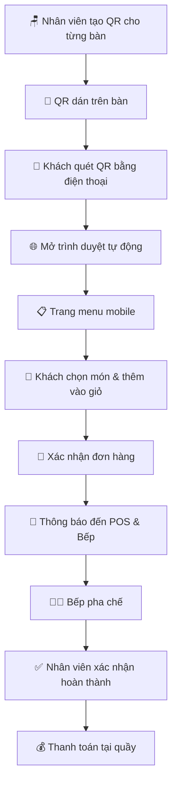
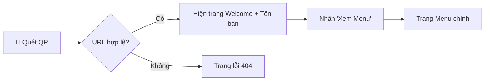
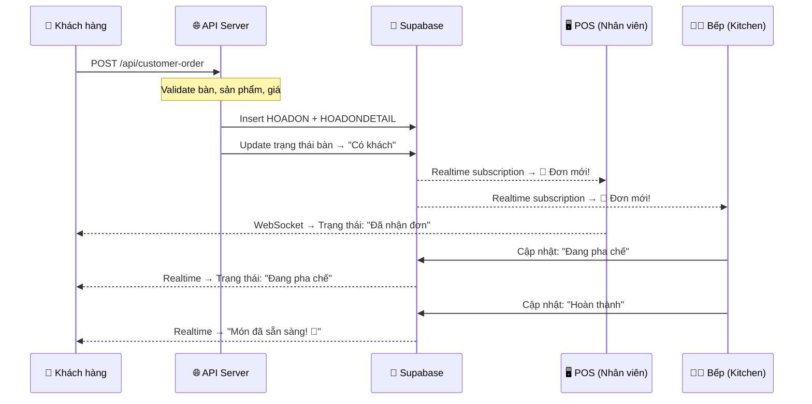
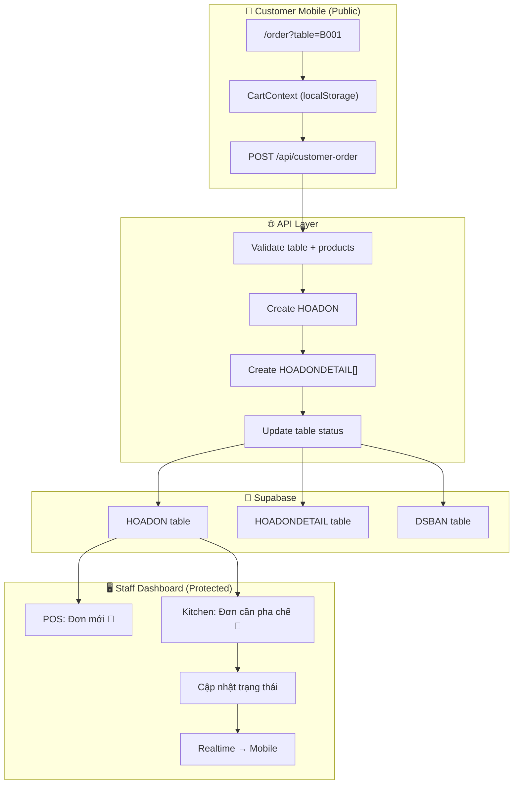
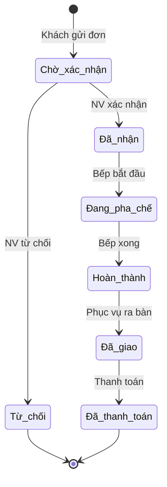

# 🎯 Kịch Bản Tính Năng: Khách Hàng Quét QR Đặt Món

## 📋 Phân Tích Hiện Trạng

### Webapp hiện tại CHƯA có tính năng mobile cho khách hàng
- Webapp hiện tại là **hệ thống POS quản lý** (dành cho nhân viên/quản lý)
- Tất cả route đều yêu cầu **đăng nhập** (middleware bảo vệ)
- Giao diện desktop-first với sidebar + header (không tối ưu cho khách hàng mobile)
- Chưa có route `/order` hay `/customer` dành cho khách hàng tự phục vụ

### Dữ liệu sẵn có để tích hợp
| Dữ liệu | File | Mô tả |
|----------|------|--------|
| Menu sản phẩm | [DMHH.json](file:///d:/Documents/H2MilkTea/src/data/DMHH.json) | 53 sản phẩm, 10 danh mục |
| Danh sách bàn | [DSBAN.json](file:///d:/Documents/H2MilkTea/src/data/DSBAN.json) | 24 bàn (nhiều khu vực) |
| Hóa đơn | [HOADON.json](file:///d:/Documents/H2MilkTea/src/data/HOADON.json) | Cấu trúc hóa đơn |
| Chi tiết HD | [HOADONDETAIL.json](file:///d:/Documents/H2MilkTea/src/data/HOADONDETAIL.json) | Chi tiết từng món |

---

## 🔄 Kịch Bản Luồng Hoạt Động (End-to-End)

### Tổng quan luồng



---

## 📐 Chi Tiết Từng Bước

### Bước 1: Tạo & Quản lý QR Code (Phía Admin/Quản lý)

> [!IMPORTANT]
> Mỗi bàn có một QR Code riêng, chứa URL dẫn đến trang order kèm mã bàn

**URL format:**
```
https://h2milktea.vercel.app/order?table={IDBAN}
```

**Ví dụ thực tế với dữ liệu hiện tại:**
| Bàn | IDBAN | URL QR |
|-----|-------|--------|
| Bàn 01 | B001 | `/order?table=B001` |
| Bàn 03 | BAN001 | `/order?table=BAN001` |
| Sofa 01 (Tầng 2) | SOFA01 | `/order?table=SOFA01` |
| Phòng VIP 01 | PHONGVIP01 | `/order?table=PHONGVIP01` |
| Khách mua về | Khách mua về | `/order?table=takeaway` |

**Tính năng cần build:**
- Nút "Tạo QR" trên trang `/tables` → generate QR code cho mỗi bàn
- Tùy chọn tải QR về dạng hình (PNG) hoặc in trực tiếp
- QR kèm logo H2 MilkTea và tên bàn bên dưới

---

### Bước 2: Khách Quét QR & Truy Cập (Phía Khách Hàng Mobile)



**Màn hình Welcome (Landing):**
- Logo H2 MilkTea
- Hiển thị: _"Chào mừng đến H2 MilkTea! Bạn đang ngồi tại **Bàn 03**"_
- Nút CTA: **"Xem Menu & Đặt Món"**
- Không yêu cầu đăng nhập/đăng ký

> [!NOTE]
> Route `/order` là route **công khai** (public), không cần authToken. Cần cập nhật middleware để cho phép truy cập.

---

### Bước 3: Giao Diện Menu Mobile (Core Feature)

**3a. Cấu trúc trang:**

```
┌─────────────────────────┐
│  🏠 H2 MilkTea          │
│  📍 Bàn 03              │
├─────────────────────────┤
│  🔍 Tìm kiếm món...     │
├─────────────────────────┤
│ [Tất cả] [Cà phê]      │
│ [Trà sữa] [Trà] [Ép]   │
│ [Sinh tố] [Ăn vặt] ... │
├─────────────────────────┤
│  ┌───────┬───────┐      │
│  │ 🖼️    │ 🖼️    │      │
│  │Cafe   │Bạc    │      │
│  │đen đá │xỉu    │      │
│  │25.000đ│30.000đ│      │
│  │ [+]   │ [+]   │      │
│  └───────┴───────┘      │
│  ┌───────┬───────┐      │
│  │ 🖼️    │ 🖼️    │      │
│  │Cafe   │Cafe   │      │
│  │sữa đá │muối   │      │
│  │28.000đ│35.000đ│      │
│  │ [+]   │ [+]   │      │
│  └───────┴───────┘      │
├─────────────────────────┤
│  🛒 Giỏ hàng (3)  150K │
│  [    Xem giỏ hàng    ] │
└─────────────────────────┘
```

**3b. Danh mục sản phẩm (từ dữ liệu thực):**

| Danh mục | Số SP | Khoảng giá |
|----------|-------|------------|
| Cà phê | 12 | 25.000đ - 45.000đ |
| Trà sữa | 18 | 28.000đ - 45.000đ |
| Trà | 4 | 20.000đ - 45.000đ |
| Nước ép | 4 | 20.000đ - 30.000đ |
| Sinh tố | 3 | 35.000đ - 40.000đ |
| Sữa chua | 3 | 28.000đ - 40.000đ |
| Đá xay | 1 | 35.000đ |
| Đồ uống nóng | 1 | 35.000đ |
| Đồ uống lạnh | 1 | 35.000đ |
| Ăn vặt | 2 | 15.000đ - 35.000đ |
| Bánh ngọt | 2 | 25.000đ - 45.000đ |

**3c. Chi tiết sản phẩm (khi tap vào):**

```
┌─────────────────────────┐
│         [X]             │
│  ┌─────────────────┐    │
│  │                 │    │
│  │    🖼️ Ảnh SP    │    │
│  │                 │    │
│  └─────────────────┘    │
│                         │
│  Cafe sữa đá            │
│  Loại: Cà phê           │
│  ★ Bán chạy             │
│                         │
│  💰 28.000đ             │
│                         │
│  ── Tùy chỉnh ──       │
│  Size:  [S] [M] [L]    │
│  Đường: [0%][30%][50%]  │
│         [70%][100%]     │
│  Đá:   [Ít][Vừa][Nhiều]│
│                         │
│  📝 Ghi chú thêm...    │
│                         │
│  Số lượng: [-] 1 [+]   │
│                         │
│ [  Thêm vào giỏ 28K   ]│
└─────────────────────────┘
```

---

### Bước 4: Giỏ Hàng & Xác Nhận Đơn

**4a. Màn hình giỏ hàng:**

```
┌─────────────────────────┐
│  🛒 Giỏ hàng của bạn    │
│  📍 Bàn 03              │
├─────────────────────────┤
│                         │
│  1x Cafe sữa đá (M)    │
│     Ít đường, Vừa đá   │
│     [-] 1 [+]  28.000đ │
│                         │
│  1x Trà sữa khoai môn  │
│     50% đường           │
│     [-] 2 [+]  70.000đ │
│                         │
│  1x Khô gà lá chanh    │
│     [-] 1 [+]  35.000đ │
│                         │
├─────────────────────────┤
│  Tạm tính:    133.000đ │
│                         │
│  📝 Ghi chú cho quán:  │
│  ┌───────────────────┐  │
│  │                   │  │
│  └───────────────────┘  │
│                         │
│ [ Thêm món ] [Đặt món] │
└─────────────────────────┘
```

**4b. Xác nhận đơn hàng:**

```
┌─────────────────────────┐
│     ✅ Đặt món          │
│     thành công!         │
│                         │
│  Mã đơn: #ORD-2025-089 │
│  Bàn: Bàn 03           │
│  Thời gian: 20:15      │
│                         │
│  ── Chi tiết ──         │
│  1x Cafe sữa đá  28K   │
│  2x Trà sữa KM   70K   │
│  1x Khô gà LC    35K   │
│  ─────────────────      │
│  Tổng:         133.000đ│
│                         │
│  ⏳ Đang chờ pha chế... │
│  ████████░░░░ 60%       │
│                         │
│  [Đặt thêm món]        │
│  [Gọi nhân viên 🔔]    │
└─────────────────────────┘
```

---

### Bước 5: Thông Báo Realtime → POS & Bếp



---

## 🧾 Nghiệp Vụ Bán Hàng POS: Thu Ngân, Khách Tại Quầy và Khách Quét QR

### Mục tiêu nghiệp vụ

POS và QR là hai kênh tạo đơn nhưng phải dùng chung một nguồn dữ liệu đơn hàng. Nhân viên thu ngân, màn hình bếp và khách tại bàn nhìn thấy cùng mã đơn và trạng thái mới nhất; không tạo hai bản ghi riêng cho một đơn và không báo thành công khi dữ liệu chưa lưu.

### Hai luồng cần hỗ trợ

#### A. Khách gọi món tại quầy (thu ngân thao tác POS)

1. Thu ngân chọn bàn hoặc **Khách mua về**, chọn món, tùy chỉnh món và xác nhận với khách.
2. POS tạo đơn ở trạng thái **Chờ bếp** sau khi lưu thành công; đơn có `source = POS_COUNTER`, nhân viên phụ trách, bàn/loại phục vụ và mã đơn duy nhất.
3. Màn bếp nhận thông báo đơn mới ngay lập tức, hiển thị nổi bật mã đơn, bàn, nguồn đơn, món, số lượng, ghi chú và thời điểm nhận.
4. Bếp cập nhật **Đang pha chế → Sẵn sàng → Đã giao**. POS nhận thông báo ở mỗi trạng thái cần thao tác; thu ngân báo khách và giao món.
5. Thanh toán có trạng thái riêng (**Chưa thanh toán / Đã thanh toán / Hoàn tiền**) và không được suy ra từ trạng thái bếp. POS hỗ trợ thu tiền trước hoặc sau khi làm món theo chính sách cửa hàng.

#### B. Khách tự gọi món tại bàn bằng QR

1. Khách quét QR, hệ thống xác thực bàn đang hoạt động và hiển thị đúng tên bàn.
2. Khách chọn món, gửi đơn; API xác thực lại bàn, mã món, giá và tùy chỉnh ở phía server.
3. Sau khi đơn được ghi bền vững vào database, POS nhận thông báo rõ **Đơn QR mới – Bàn X – mã đơn**. Trạng thái ban đầu là **Chờ thu ngân xác nhận**; đơn chưa được chuyển bếp cho đến khi nhân viên chấp nhận (trừ khi cửa hàng bật chế độ tự động nhận).
4. Thu ngân chấp nhận hoặc từ chối đơn. Khi chấp nhận, đơn chuyển sang **Chờ bếp**, bếp được thông báo. Khi từ chối, phải có lý do và khách nhìn thấy trạng thái/lý do đó.
5. Bếp cập nhật trạng thái; POS và trang khách cùng nhận cập nhật. Khách thấy thông báo **Đang pha chế**, **Món đã sẵn sàng**, hoặc **Cần nhân viên hỗ trợ**. Thanh toán tại quầy được ghi nhận riêng.
6. Khách có thể gửi thêm món vào cùng bàn. Mỗi lần gửi tạo một mã đơn/nhóm món mới, giữ liên kết với phiên bàn hiện tại và tránh ghi đè đơn đang làm.

### Trạng thái chuẩn và quy tắc chuyển trạng thái

Lưu trạng thái nghiệp vụ dạng mã ổn định; giao diện hiển thị nhãn tiếng Việt. Tách trạng thái xử lý đơn, trạng thái bếp và thanh toán để tránh nhập nhằng:

| Trường | Trạng thái đề xuất | Ghi chú |
|---|---|---|
| `order_status` | `awaiting_confirmation`, `accepted`, `rejected`, `completed`, `cancelled` | Dùng cho quyết định của thu ngân và vòng đời đơn |
| `kitchen_status` | `queued`, `preparing`, `ready`, `served` | Bếp cập nhật theo tiến độ làm món |
| `payment_status` | `unpaid`, `paid`, `refunded` | POS cập nhật độc lập với bếp |
| `source` | `POS_COUNTER`, `QR_TABLE` | Hiển thị rõ nguồn đơn trên POS/bếp |

Mọi lần chuyển trạng thái phải kiểm tra trạng thái hiện tại và quyền người thao tác, lưu `updated_at`, `updated_by` và lịch sử sự kiện. Không cho bếp tự đánh dấu thanh toán; không cho khách gọi trực tiếp endpoint đổi trạng thái.

### Đồng bộ realtime và thông báo

- Database là nguồn dữ liệu chuẩn. Ghi đơn và chi tiết đơn phải nguyên tử (transaction hoặc RPC); chỉ phản hồi thành công sau khi ghi hoàn tất.
- Dùng Supabase Realtime trên các bảng đơn/chi tiết hoặc bảng sự kiện. Không dùng biến mảng trong bộ nhớ hoặc WebSocket chạy ở `localhost` làm kênh production trên Vercel.
- POS subscribe theo cửa hàng/chi nhánh và nhận `order.created`, `order.accepted`, `order.rejected`, `kitchen.status_changed`, `payment.status_changed`.
- Màn bếp subscribe đơn đã được chấp nhận; có âm báo và badge số đơn mới. Mỗi đơn QR phải nổi bật nguồn **QR**, bàn và tuổi đơn; đơn chờ xác nhận không bị trộn với hàng đợi đã nhận làm.
- Trang khách subscribe theo mã đơn bằng quyền truy cập giới hạn; chỉ đọc trạng thái đơn của chính mình. Khi mất kết nối, hiển thị trạng thái mất kết nối và đồng bộ lại snapshot khi nối lại.
- Realtime là kênh báo nhanh, không phải nguồn duy nhất: khi tải trang/kết nối lại, fetch snapshot từ database; dùng polling dự phòng có backoff nếu subscription lỗi.
- Thông báo trong POS/bếp cần banner hoặc toast dễ thấy, badge chưa đọc, thời gian và âm báo có bật/tắt. Âm báo chỉ phát sau khi người dùng cho phép/tương tác với trang; có thao tác đánh dấu đã xem.
- Dùng `event_id`/`order_id` để chống xử lý lặp, `version` hoặc `updated_at` để bỏ qua event cũ; retry có giới hạn và log lỗi gửi/nhận.

### Những gì mã hiện tại đã có và còn thiếu (đối chiếu repository)

| Khu vực | Hiện trạng | Việc cần bổ sung |
|---|---|---|
| POS thu ngân | Có giỏ hàng, chọn bàn, lưu hóa đơn/chi tiết qua `authUtils`; có hàm gửi đơn bếp | Chuẩn hóa tạo order chung, `source`, trạng thái riêng, liên kết đơn–hóa đơn và xác nhận gửi bếp |
| QR order | Có menu/giỏ và API tạo hóa đơn Supabase | API hiện chưa xác thực đầy đủ bàn/sản phẩm/giá, có thể trả thành công khi Supabase ghi thất bại; cần ghi transaction và chỉ báo thành công sau khi lưu |
| Hàng đợi bếp | `/api/kitchen/orders` dùng mảng trong memory nên mất dữ liệu khi cold start/scale nhiều serverless instance | Đọc/ghi database; chỉ đưa đơn đã chấp nhận vào hàng đợi bếp |
| Màn hình bếp | `src/app/(dashboard)/kitchen/components/KitchenDisplay.tsx` polling mỗi 3 giây; một KitchenDisplay khác cố kết nối `ws://localhost:3001` | Dùng chung một realtime client/serverless-compatible; bỏ endpoint localhost khỏi production; giữ snapshot/polling dự phòng |
| Đồng bộ POS ↔ QR ↔ bếp | Chưa có subscription realtime thống nhất; QR thành công không phát sự kiện đến POS/bếp | Thiết lập subscriptions cho POS, bếp và khách; kiểm tra quyền, reconnect, duplicate events |
| Trạng thái cho khách | Màn thành công QR hiển thị trạng thái tĩnh | Thêm trang `/order/status?order=...` đọc trạng thái thật, chỉ truy cập đơn của khách tương ứng |
| Thông báo thu ngân | POS hiện có toast cục bộ khi thao tác của chính nhân viên thành công | Thêm inbox/banner đơn QR mới, badge, âm báo, chấp nhận/từ chối và lý do |
| An toàn và tin cậy | Chưa có idempotency/rate limit đầy đủ cho submit QR | Chống gửi trùng khi khách bấm nhiều lần/mạng chập chờn; giới hạn tốc độ, validate server-side, log audit |

### Kế hoạch triển khai theo ưu tiên

### Cập nhật thực hiện (14/10/2026)

Đã bổ sung phần triển khai ban đầu cho luồng bán hàng đồng bộ:

- [x] Tạo schema đơn dùng chung `pos_orders`, có nguồn đơn, trạng thái bếp/thanh toán, mã chống gửi trùng và phiên bản trạng thái.
- [x] Tạo API chung cho POS/QR, kiểm tra bàn/sản phẩm/giá/số lượng phía server và chỉ báo thành công sau khi Supabase ghi nhận.
- [x] POS gửi đơn quầy vào hàng đợi bếp; QR tạo đơn chờ thu ngân duyệt; thu ngân có thể nhận/từ chối (bắt buộc lý do) hoặc mở đơn đã nhận để thu tiền.
- [x] Bếp đọc đơn đã nhận từ database, cập nhật tiến độ; POS/bếp có Supabase Realtime và polling dự phòng; khách có trang theo dõi trạng thái.
- [x] Thay endpoint bếp dùng bộ nhớ và WebSocket `localhost` bằng nguồn đơn Supabase; thêm phân biệt nguồn QR/quầy trên thẻ bếp.
- [x] Lưu tạm hóa đơn POS hiện có và liên kết trạng thái thanh toán với đơn mới; tổng tiền QR hiện tính VAT 10% giống POS.

**Còn cần hoàn tất trước khi dùng production:** áp dụng migration `supabase/migrations/202610140001_pos_orders.sql` vào đúng Supabase project; xác nhận quyền/phiên đăng nhập Realtime trên tài khoản nhân viên; chạy thử trực tiếp hai luồng, hai thiết bị và cold start Vercel. Migration chưa được áp dụng tự động từ mã nguồn. Nhật ký lịch sử trạng thái, rate limit dùng kho dữ liệu chia sẻ, chế độ tự nhận đơn, xử lý hoàn tiền và gửi thêm món theo một phiên bàn vẫn là phần tiếp theo, chưa nằm trong bản triển khai này.

#### Phase A — Chuẩn hóa dữ liệu và bảo đảm lưu đơn

1. ✅ Schema đơn dùng chung đã có migration; quan hệ với `HOADON`/`HOADONDETAIL` hiện qua `invoice_id`, vẫn cần áp dụng migration và xác nhận trên Supabase thật.
2. ✅ Có nguồn đơn, trạng thái, người nhận, timestamps, `idempotency_key`; lịch sử sự kiện riêng chưa làm.
3. ✅ POS và QR dùng chung API có kiểm tra dữ liệu server-side; ghi đơn hiện là một bản ghi JSONB, cần RPC/transaction nếu sau này tách chi tiết.
4. ✅ Không báo thành công khi lỗi lưu; service-role key chỉ dùng server-side; migration bật RLS. Cần kiểm tra quyền Realtime thực tế sau khi áp dụng.

#### Phase B — Tiếp nhận QR và thông báo thu ngân

5. ✅ QR submit tạo đơn `awaiting_confirmation`; POS có inbox và cập nhật realtime/polling.
6. ✅ Thu ngân chấp nhận/từ chối, yêu cầu lý do và dùng cập nhật có điều kiện trạng thái/version.
7. 🔲 Chưa có cấu hình tự nhận đơn; hiện luôn yêu cầu thu ngân duyệt.

#### Phase C — Realtime bếp và trạng thái khách

8. ✅ Bếp dùng database, nhận đơn đã duyệt; realtime và cập nhật trạng thái khách qua broadcast.
9. ✅ Có âm báo đơn mới, chỉ báo kết nối và polling dự phòng; 🔲 chưa có cảnh báo đơn chờ lâu riêng.
10. ✅ Có trang trạng thái đơn QR theo token riêng; 🔲 nút đặt thêm món tạo đơn mới, chưa gắn nhóm phiên bàn.

#### Phase D — Đối soát và vận hành

11. Đồng bộ đơn – hóa đơn – thanh toán; xử lý hủy/hoàn tiền; phân biệt doanh thu đã thanh toán với món đang làm.
12. Thêm nhật ký ai nhận/từ chối/chuyển trạng thái/thanh toán; dashboard lọc theo nguồn QR/quầy.
13. Kiểm thử tải đồng thời, gửi lặp, rớt mạng, reconnect, cold start Vercel và hai nhân viên cùng nhận một đơn.

### Tiêu chí nghiệm thu nghiệp vụ

- Đơn gửi từ POS và QR xuất hiện đúng một lần trong database; có thể truy ra kênh, bàn, thu ngân và các món.
- Thu ngân thấy đơn QR mới trong vài giây khi mạng bình thường; bếp chỉ nhận sau khi đơn được chấp nhận (hoặc theo cấu hình tự nhận).
- Chuyển trạng thái tại bếp cập nhật POS và khách trong vài giây; refresh/reconnect vẫn đọc đúng trạng thái từ database.
- Khách không thấy “thành công” nếu API chưa lưu; gửi lại cùng idempotency key không tạo đơn trùng.
- Từ chối/hủy/thanh toán có trạng thái, người thao tác và thông báo phù hợp; trạng thái bếp không tự thay đổi trạng thái thanh toán.
- Không cần WebSocket server cố định hoặc dữ liệu memory để chạy trên Vercel; có fallback khi realtime gián đoạn.

---

## 🏗️ Kiến Trúc Kỹ Thuật

### Cấu trúc thư mục mới cần tạo

```
src/
├── app/
│   ├── order/                          ← 🆕 PUBLIC route (không cần auth)
│   │   ├── layout.tsx                  ← Layout mobile-first, không sidebar
│   │   ├── page.tsx                    ← Landing/Welcome page
│   │   ├── menu/
│   │   │   └── page.tsx               ← Menu browser + product cards
│   │   ├── cart/
│   │   │   └── page.tsx               ← Giỏ hàng + xác nhận
│   │   ├── status/
│   │   │   └── page.tsx               ← Theo dõi trạng thái đơn
│   │   ├── components/
│   │   │   ├── CustomerHeader.tsx      ← Header nhỏ gọn cho mobile
│   │   │   ├── CategoryTabs.tsx        ← Tab danh mục ngang (scroll)
│   │   │   ├── ProductCard.tsx         ← Card sản phẩm 2 cột
│   │   │   ├── ProductDetail.tsx       ← Bottom sheet chi tiết SP
│   │   │   ├── CartFloatingBar.tsx     ← Thanh giỏ hàng cố định dưới
│   │   │   ├── CartItem.tsx            ← Item trong giỏ
│   │   │   ├── OrderConfirmation.tsx   ← Popup xác nhận thành công
│   │   │   └── OrderStatus.tsx         ← Tracking trạng thái
│   │   ├── hooks/
│   │   │   ├── useCart.ts              ← Logic giỏ hàng (localStorage)
│   │   │   ├── useMenu.ts             ← Fetch & filter menu
│   │   │   └── useOrderStatus.ts      ← Realtime tracking
│   │   ├── types/
│   │   │   └── customer-order.ts       ← Types cho order khách
│   │   └── context/
│   │       └── CartContext.tsx          ← Cart state management
│   │
│   ├── api/
│   │   ├── customer-order/             ← 🆕 API cho khách đặt món
│   │   │   └── route.ts
│   │   └── qr-generate/               ← 🆕 API tạo QR code
│   │       └── route.ts
│   │
│   └── (dashboard)/
│       └── tables/
│           └── components/
│               └── QRCodeGenerator.tsx ← 🆕 Nút tạo QR trên trang bàn
```

### Cập nhật Middleware

```diff
// src/middleware.ts
const publicRoutes = [
    '/',           // Trang login
    '/not-found',  // Trang 404
+   '/order',      // 🆕 Trang order cho khách hàng
];

const validRoutes = [
    // ... existing routes
+   '/order',
+   '/order/menu',
+   '/order/cart',
+   '/order/status',
];
```

### Data Flow



---

## 🎨 Thiết Kế UI/UX Mobile

### Nguyên tắc thiết kế
- **Mobile-first**: Tối ưu cho màn hình 375px - 428px
- **Touch-friendly**: Các nút tối thiểu 44x44px
- **Không login**: Trải nghiệm mượt mà, không rào cản
- **Fast loading**: Lazy load hình ảnh, skeleton loading
- **Dark/Light mode**: Theo system preference

### Color Palette cho Customer App
| Element | Light Mode | Dark Mode |
|---------|-----------|-----------|
| Primary | `#DC2626` (đỏ H2) | `#EF4444` |
| Background | `#FFF7ED` (kem nhẹ) | `#1C1917` |
| Card | `#FFFFFF` | `#292524` |
| Text | `#1C1917` | `#F5F5F4` |
| Accent | `#F97316` (cam) | `#FB923C` |

---

## 📊 Trạng Thái Đơn Hàng



---

## 🚀 Kế Hoạch Triển Khai (Phân Pha)

### Phase 1: Core MVP ⭐ (Ưu tiên cao)
1. ✅ Tạo route `/order` (public, mobile layout)
2. ✅ Trang Welcome + validate bàn
3. ✅ Menu browser với category filter + search
4. ✅ Chi tiết sản phẩm (bottom sheet)
5. ✅ Giỏ hàng (CartContext + localStorage)
6. ✅ API `/api/customer-order` → tạo hóa đơn
7. ✅ Cập nhật middleware cho public route
8. ✅ QR Generator trên trang quản lý bàn

### Phase 2: Realtime & UX ⚡
9. 🔲 Realtime order tracking (Supabase Realtime)
10. 🔲 Thông báo đẩy đến POS khi có đơn mới
11. 🔲 Tích hợp vào Kitchen display
12. 🔲 Nút "Gọi nhân viên"
13. 🔲 Đặt thêm món sau khi đã gửi đơn

### Phase 3: Nâng cao 🌟
14. 🔲 Thanh toán online (PayOS integration - đã có trong deps)
15. 🔲 Chương trình tích điểm khách hàng
16. 🔲 Đánh giá món ăn sau khi dùng
17. 🔲 Lịch sử đặt món (cookie-based)
18. 🔲 Đa ngôn ngữ (Việt/English)

---

## ⚠️ Lưu Ý Kỹ Thuật

> [!WARNING]
> **Bảo mật:** Route `/order` là public nhưng cần:
> - Rate limiting cho API customer-order (chống spam)
> - Validate IDBAN phải tồn tại trong DSBAN
> - Validate IDSP và giá phải khớp server-side (không tin client)
> - Giới hạn số lượng tối đa mỗi món (VD: max 10)

> [!TIP]
> **Supabase Realtime** đã có trong deps (`@supabase/supabase-js`). Sử dụng channel subscription để push thông báo đơn mới đến POS/Kitchen realtime.

> [!NOTE]
> **PayOS** đã có trong deps (`@payos/node`, `@payos/payos-checkout`). Có thể tích hợp thanh toán QR ngay trong Phase 3.
