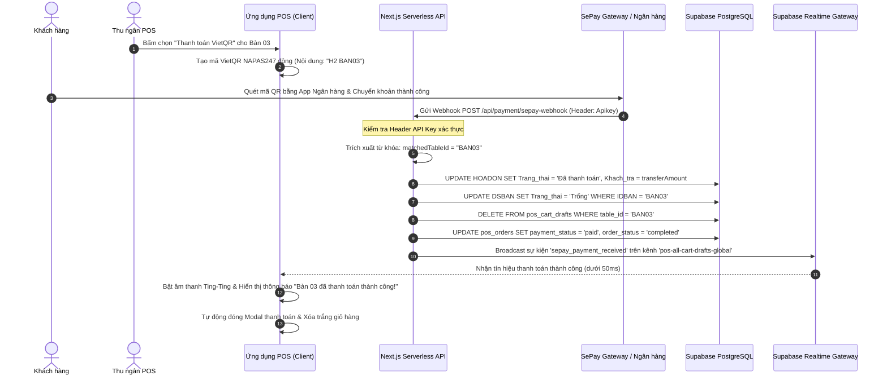
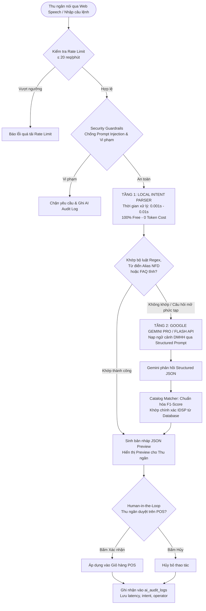
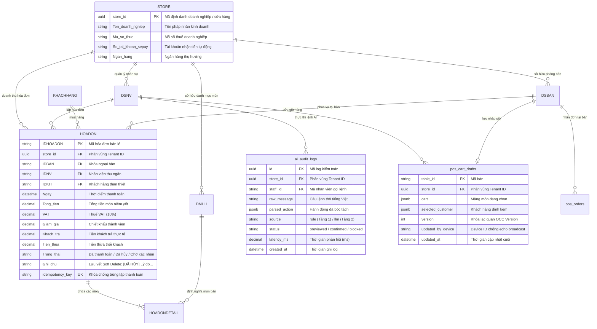

# BÁO CÁO ĐỒ ÁN TỐT NGHIỆP KỸ SƯ CÔNG NGHỆ THÔNG TIN

## ĐỀ TÀI:
# HỆ THỐNG QUẢN LÝ BÁN HÀNG POS & GỌI MÓN THÔNG MINH H2MILKTEA TÍCH HỢP TRỢ LÝ AI COPILOT VÀ ĐỐI SOÁT THANH TOÁN TỰ ĐỘNG

---

**Cơ quan chủ quản**: Bộ Giao thông Vận tải  
**Đơn vị đào tạo**: Trường Đại học Công nghệ Giao thông Vận tải (UTT)  
**Khoa**: Công nghệ Thông tin  
**Chuyên ngành**: Kỹ thuật Phần mềm / Hệ thống Thông tin  
**Giảng viên hướng dẫn & Cố vấn học thuật**: Chief Academic Advisor  
**Hệ đào tạo**: Đại học Chính quy  
**Năm hoàn thành**: 2026  

---

## MỤC LỤC TỔNG QUAN

- [LỜI MỞ ĐẦU & TÓM TẮT ĐỀ TÀI](#lời-mở-đầu--tóm-tắt-đề-tài)
- [CHƯƠNG 1: TỔNG QUAN VỀ ĐỀ TÀI & NGHIỆP VỤ F&B](#chương-1-tổng-quan-về-đề-tài--nghiệp-vụ-fb)
  - [1.1. Bối cảnh thực tiễn ngành F&B và chuyển đổi số cửa hàng đồ uống](#11-bối-cảnh-thực-tiễn-ngành-fb-và-chuyển-đổi-số-cửa-hàng-đồ-uống)
  - [1.2. Những nút thắt kỹ thuật của hệ thống POS truyền thống](#12-những-nút-thắt-kỹ-thuật-của-hệ-thống-pos-truyền-thống)
  - [1.3. Mục tiêu và phạm vi nghiên cứu của đề tài H2MilkTea](#13-mục-tiêu-và-phạm-vi-nghiên-cứu-của-đề-tài-h2milktea)
- [CHƯƠNG 2: PHÂN TÍCH YÊU CẦU & CÔNG NGHỆ LỰA CHỌN](#chương-2-phân-tích-yêu-cầu--công-nghệ-lựa-chọn)
  - [2.1. Phân tích yêu cầu chức năng và phi chức năng](#21-phân-tích-yêu-cầu-chức-năng-và-phi-chức-năng)
  - [2.2. Lựa chọn nền tảng công nghệ (Tech Stack Rationale)](#22-lựa-chọn-nền-tảng-công-nghệ-tech-stack-rationale)
- [CHƯƠNG 3: THIẾT KẾ KIẾN TRÚC HỆ THỐNG & CƠ SỞ DỮ LIỆU](#chương-3-thiết-kế-kiến-trúc-hệ-thống--cơ-sở-dữ-liệu)
  - [3.1. Kiến trúc tổng thể 4 tầng (Next.js 15, Serverless, Supabase Realtime)](#31-kiến-trúc-tổng-thể-4-tầng-nextjs-15-serverless-supabase-realtime)
  - [3.2. Trụ cột 1: Thuật toán chống xung đột giỏ hàng Realtime (OCC, Device-ID Filtering, In-Flight Guard)](#32-trụ-cột-1-thuật-toán-chống-xung-đột-giỏ-hàng-realtime-occ-device-id-filtering-in-flight-guard)
  - [3.3. Trụ cột 2: Tự động hóa đối soát thanh toán SePay Webhook & VietQR NAPAS247](#33-trụ-cột-2-tự-động-hóa-đối-soát-thanh-toán-sepay-webhook--vietqr-napas247)
  - [3.4. Trụ cột 3: Kiến trúc Trợ lý AI Copilot 2 tầng (Hybrid Edge Pipeline: 0.01s Rule Engine & Gemini Pro API)](#34-trụ-cột-3-kiến-trúc-trợ-lý-ai-copilot-2-tầng-hybrid-edge-pipeline-001s-rule-engine--gemini-pro-api)
  - [3.5. Trụ cột 4: Cơ chế chống thất thoát hóa đơn Soft Delete & Kiến trúc CSDL Đa doanh nghiệp Multi-Tenant SaaS RLS](#35-trụ-cột-4-cơ-chế-chống-thất-thoát-hóa-đơn-soft-delete--kiến-trúc-csdl-đa-doanh-nghiệp-multi-tenant-saas-rls)
  - [3.6. Thiết kế Cơ sở dữ liệu và Sơ đồ Thực thể Quan hệ (ERD Mở rộng)](#36-thiết-kế-cơ-sở-dữ-liệu-và-sơ-đồ-thực-thể-quan-hệ-erd-mở-rộng)
- [CHƯƠNG 4: TRIỂN KHAI, ĐO LƯỜNG & KẾT QUẢ THỰC NGHIỆM](#chương-4-triển-khai-đo-lường--kết-quả-thực-nghiệm)
  - [4.1. Thống kê kết quả kiểm thử tự động (25 Test Suites / 165 Unit Tests đạt 100%)](#41-thống-kê-kết-quả-kiểm-thử-tự-động-25-test-suites--165-unit-tests-đạt-100)
  - [4.2. Kết quả đo lường độ trễ và chi phí vận hành Trợ lý AI (Latency Benchmark & Token Cost)](#42-kết-quả-đo-lường-độ-trễ-và-chi-phí-vận-hành-trợ-lý-ai-latency-benchmark--token-cost)
  - [4.3. Kết quả tối ưu giao diện POS thu phóng thích ứng (UI/UX Responsiveness 1024x768 - 4K)](#43-kết-quả-tối-ưu-giao-diện-pos-thu-phóng-thích-ứng-uiux-responsiveness-1024x768---4k)
  - [4.4. Đánh giá tính toàn vẹn kế toán và ngăn ngừa gian lận (Loss Audit Prevention)](#44-đánh-giá-tính-toàn-vẹn-kế-toán-và-ngăn-ngừa-gian-lận-loss-audit-prevention)
- [CHƯƠNG 5: ĐÁNH GIÁ, KẾT LUẬN & HƯỚNG PHÁT TRIỂN MULTI-TENANT SAAS](#chương-5-đánh-giá-kết-luận--hướng-phát-triển-multi-tenant-saas)
  - [5.1. So sánh các mô hình SaaS và lý do chọn Shared Database + PostgreSQL RLS](#51-so-sánh-các-mô-hình-saas-và-lý-do-chọn-shared-database--postgresql-rls)
  - [5.2. Lộ trình thương mại hóa và mở rộng chuỗi nhượng quyền F&B](#52-lộ-trình-thương-mại-hóa-và-mở-rộng-chuỗi-nhượng-quyền-fb)
  - [5.3. Kết luận và đóng góp khoa học - thực tiễn của đồ án](#53-kết-luận-và-đóng-góp-khoa-học---thực-tiễn-của-đồ-án)
- [TÀI LIỆU THAM KHẢO](#tài-liệu-tham-khảo)

---

## LỜI MỞ ĐẦU & TÓM TẮT ĐỀ TÀI

Ngành kinh doanh Dịch vụ Ẩm thực và Đồ uống (Food & Beverage - F&B), tiêu biểu là các chuỗi trà sữa và cà phê, đang chứng kiến tốc độ số hóa mạnh mẽ cùng áp lực phục vụ cực cao trong các khung giờ cao điểm. Những vấn đề nhức nhối thường trực tại các quầy thu ngân bao gồm:
1. **Xung đột đơn hàng khi nhiều nhân viên thao tác đồng thời**: Tình trạng ghi đè giỏ hàng, mất món hoặc sai lệch số lượng khi thu ngân dùng iPad nhận gọi món tại bàn cùng lúc với thu ngân tại máy POS cố định.
2. **Nghẽn khâu thanh toán chuyển khoản**: Nhân viên phải dừng thao tác để nhìn màn hình điện thoại chụp bill chuyển khoản của khách, đối chiếu mã giao dịch thủ công gây ùn ứ hàng dài khách chờ đợi và tiềm ẩn nguy cơ làm giả ảnh chụp bill (fake bill).
3. **Chi phí và độ trễ khi ứng dụng AI**: Việc tích hợp các mô hình ngôn ngữ lớn (LLM) trực tiếp vào nghiệp vụ bán hàng thường gặp rào cản về chi phí token quá cao và độ trễ phản hồi từ 2 đến 5 giây, không đáp ứng được tiêu chuẩn thao tác dưới 1 giây tại quầy POS.
4. **Thất thoát tài chính do thiếu lưu vết**: Việc nhân viên tự ý hủy hóa đơn sau khi thu tiền mặt của khách mà không có sự kiểm soát chặt chẽ dẫn đến thâm hụt doanh thu nghiêm trọng.
5. **Rào cản mở rộng đa chi nhánh (Multi-Tenant)**: Khó khăn trong việc cô lập dữ liệu an toàn giữa các cửa hàng khác nhau khi chuyển đổi sang mô hình phần mềm dịch vụ (SaaS).

Đề tài **"Hệ thống Quản lý Bán hàng POS & Gọi món Thông minh H2MilkTea"** được nghiên cứu và phát triển nhằm giải quyết triệt để các bài toán trên thông qua 4 trụ cột công nghệ cốt lõi:
- **Trụ cột 1**: Thuật toán chống xung đột giỏ hàng Realtime đa thiết bị kết hợp Khóa lạc quan (OCC), Bộ lọc định danh thiết bị (`Device-ID filtering`) và Cơ chế bảo vệ thao tác dở dang (`In-flight debounce guard`).
- **Trụ cột 2**: Tự động hóa đối soát thanh toán tức thời qua SePay Webhook kết hợp Realtime POS broadcast và mã định danh động VietQR NAPAS247.
- **Trụ cột 3**: Kiến trúc Trợ lý AI Copilot 2 tầng (Hybrid Edge Pipeline): Tầng 1 Local Intent Parser (Regex & Knowledge Cache) phản hồi tức thì $\approx 0.01$s với 0 đồng chi phí token, tự động chuyển tầng 2 Google Gemini Pro/Flash API cho các câu hỏi mở phức tạp.
- **Trụ cột 4**: Cơ chế chống thất thoát tài chính Soft Delete có lưu vết kiểm toán (Audit Trail) kết hợp Kiến trúc phân tách CSDL Đa doanh nghiệp Multi-Tenant SaaS dựa trên Row-Level Security (RLS) của PostgreSQL.

Hệ thống đã trải qua quá trình kiểm thử tự động nghiêm ngặt với **25 test suites / 165 unit tests đạt tỷ lệ vượt qua 100%**, chứng minh tính ổn định, độ tin cậy và khả năng ứng dụng thực tiễn cao trong môi trường kinh doanh thực tế.

---

# CHƯƠNG 1: TỔNG QUAN VỀ ĐỀ TÀI & NGHIỆP VỤ F&B

## 1.1. Bối cảnh thực tiễn ngành F&B và chuyển đổi số cửa hàng đồ uống
Thị trường trà sữa và đồ uống pha chế tại Việt Nam có tính cạnh tranh khốc liệt và đặc thù vận hành với lượng khách biến động mạnh. Vào khung giờ vàng (19h00 - 21h30), một cửa hàng quy mô vừa có thể tiếp nhận từ 80 đến 150 giao dịch mỗi giờ. Mỗi đơn hàng bao gồm nhiều tùy biến phức tạp (kích cỡ ly, % đường, % đá, nhiều loại topping đi kèm) và các hình thức phục vụ hỗn hợp: khách ngồi tại bàn, khách mua mang về, khách tự đặt qua mã QR bàn.

## 1.2. Những nút thắt kỹ thuật của hệ thống POS truyền thống
- **Hiện tượng "Lost Update"**: Khi 2 thu ngân cùng cập nhật giỏ hàng của Bàn 03, thiết bị lưu sau cùng sẽ ghi đè toàn bộ dữ liệu của thiết bị trước, dẫn đến việc thiếu món của khách.
- **Điểm nghẽn xác nhận thanh toán (Payment Bottleneck)**: Tỷ lệ thanh toán không dùng tiền mặt (VietQR) hiện chiếm trên 70% tổng số giao dịch. Việc nhân viên phải chờ SMS thông báo biến động số dư hoặc kiểm tra thủ công ứng dụng ngân hàng khiến thời gian hoàn tất đơn kéo dài thêm 30 - 60 giây mỗi khách.
- **Rủi ro xóa trắng dữ liệu (Hard Delete)**: Khi một hóa đơn bị xóa vĩnh viễn khỏi CSDL, chủ cửa hàng hoàn toàn mất dấu vết kiểm toán, tạo kẽ hở cho hành vi gian lận thông đồng giữa thu ngân và pha chế.

## 1.3. Mục tiêu và phạm vi nghiên cứu của đề tài H2MilkTea
- Xây dựng giải pháp POS hiện đại trên nền tảng Web tiêu chuẩn, hoạt động mượt mà trên đa dạng thiết bị (máy POS chuyên dụng cảm ứng, iPad, máy tính để bàn, điện thoại cá nhân).
- Hiện thực hóa cơ chế đồng bộ giỏ hàng thời gian thực (Realtime Collaborative Cart) với độ trễ dưới 50ms và không xảy ra xung đột dữ liệu.
- Tự động hóa 100% quy trình đối soát giao dịch ngân hàng qua cổng Webhook SePay, tự động đóng hóa đơn, giải phóng bàn và in tem pha chế.
- Ứng dụng trí tuệ nhân tạo (AI Copilot) phục vụ bán hàng với chi phí vận hành tiệm cận 0 đồng cho các tác vụ thường nhật.
- Xây dựng nền tảng kiến trúc sẵn sàng mở rộng thành mô hình SaaS phục vụ chuỗi thương hiệu thông qua cơ chế phân tách dữ liệu an toàn.

---

# CHƯƠNG 2: PHÂN TÍCH YÊU CẦU & CÔNG NGHỆ LỰA CHỌN

## 2.1. Phân tích yêu cầu chức năng và phi chức năng
### Yêu cầu chức năng (Functional Requirements):
1. **Quản lý bán hàng & POS quầy**: Chọn món, tùy biến đường/đá/topping, tách gộp bàn, chuyển bàn, áp dụng chiết khấu thành viên.
2. **Khách hàng tự gọi món qua QR tại bàn (Self-ordering QR)**: Quét mã QR nhận diện bàn, gửi đơn nháp có chữ ký bảo mật và hạn thời gian (TTL).
3. **Màn hình điều phối bếp (KDS - Kitchen Display System)**: Nhận đơn thời gian thực, hiển thị trạng thái pha chế, hỗ trợ in tem nhãn ly trà sữa.
4. **Đối soát thanh toán tự động**: Tích hợp mã VietQR NAPAS247 động, tự động nhận diện thông tin thanh toán qua Webhook.
5. **Trợ lý AI bán hàng đa năng**: Nhận lệnh bằng giọng nói tiếng Việt, nhận diện món viết tắt, tra cứu thực đơn và chính sách quán.
6. **Báo cáo tài chính & Thống kê thất thoát**: Quản lý lịch sử hóa đơn, cơ chế Soft Delete có lý do và người chịu trách nhiệm, phân tích thất thoát do hủy đơn.

### Yêu cầu phi chức năng (Non-Functional Requirements):
- **Độ sẵn sàng & Tính nhất quán (High Availability & Consistency)**: Xử lý đồng thời không nghẽn, đảm bảo tính lũy đẳng (Idempotency) tuyệt đối trong thanh toán.
- **Hiệu năng cao (High Performance)**: Thời gian tải trang ban đầu $< 1.5$s; độ trễ xử lý AI cục bộ $< 10$ms; độ trễ đồng bộ WebSocket $< 100$ms.
- **Bảo mật nhiều lớp (Defense-in-Depth)**: Kiến trúc Zero Trust, phân quyền dựa trên vai trò (RBAC), bảo vệ chống tấn công CSRF/XSS, Row-Level Security ở tầng nhân PostgreSQL.

## 2.2. Lựa chọn nền tảng công nghệ (Tech Stack Rationale)

| Tầng công nghệ | Công nghệ lựa chọn | Lý do và Giá trị kỹ thuật |
| :--- | :--- | :--- |
| **Giao diện & Ứng dụng** | Next.js 15 (App Router), React 19, TypeScript | Server-Side Rendering (SSR) kết hợp Client Components tối ưu hiệu năng; App Router hiện đại; TypeScript ngăn ngừa lỗi kiểu dữ liệu lúc runtime. |
| **Styling & UI Kit** | Tailwind CSS, Shadcn UI, Lucide Icons | Thiết kế giao diện phẳng, tối ưu hóa CSS bundle size, khả năng co giãn linh hoạt theo tỷ lệ màn hình POS. |
| **Cơ sở dữ liệu & Realtime** | Supabase (PostgreSQL 15), Supabase Realtime Gateway | RDBMS quan hệ mạnh mẽ, hỗ trợ kiểu dữ liệu JSONB linh hoạt, cơ chế Pub/Sub qua WebSocket gốc, tích hợp sẵn Row-Level Security. |
| **Xử lý Ngôn ngữ Tự nhiên** | Local Rule Engine (NFD, Regex) & Google Gemini Pro/Flash API | Kiến trúc Hybrid 2 tầng giúp loại bỏ chi phí token cho các câu lệnh POS lặp lại, đồng thời giữ khả năng xử lý ngữ nghĩa phức tạp của Foundation Model. |
| **Cổng thanh toán** | SePay Webhook Engine & VietQR NAPAS247 | Chuẩn thanh toán quốc gia VietQR, đối soát tài khoản ngân hàng tức thời qua Webhook mà không cần ký quỹ doanh nghiệp phức tạp. |
| **Kiểm thử tự động** | Vitest, Testing Library, Supertest | Khung kiểm thử tốc độ cao, hỗ trợ ESM gốc, cho phép giả lập (mock) toàn diện các luồng mạng, database và timer. |

---

# CHƯƠNG 3: THIẾT KẾ KIẾN TRÚC HỆ THỐNG & CƠ SỞ DỮ LIỆU

## 3.1. Kiến trúc tổng thể 4 tầng (Next.js 15, Serverless, Supabase Realtime)

```
+---------------------------------------------------------------------------------------+
|                                    TẦNG CLIENT                                        |
|  [POS Thu ngân Quầy]      [Khách quét QR Bàn]      [Màn hình Bếp KDS]    [Admin Cài đặt] |
|   (useSharedCartDraft)      (Token QR / Order)       (Realtime Orders)    (Audit & RLS)   |
+---------------------------------------------------------------------------------------+
                                        | (HTTPS / WSS)
+---------------------------------------------------------------------------------------+
|                             TẦNG GATEWAY & MIDDLEWARE                                 |
|  - Next.js Edge Middleware: Correlation-ID Tracking, Cookie Auth Validation, Route Guard |
|  - Supabase Realtime Gateway: Kênh WebSocket Broadcast & Postgres Changes            |
+---------------------------------------------------------------------------------------+
                                        |
+---------------------------------------------------------------------------------------+
|                            TẦNG SERVERLESS API SERVICES                               |
|  [/api/orders]              [/api/pos/cart-draft]       [/api/payment/sepay-webhook]  |
|  (Tra cứu giá gốc DMHH,     (Khóa lạc quan OCC,         (Xác thực API Key, Parser     |
|   Kiểm tra Idempotency)      Merge giỏ hàng)             mã hóa đơn/bàn, Broadcast)    |
|                                                                                       |
|  [/api/ai/chat]                                         [/api/invoices]               |
|  (Rule Engine 0.01s, Fallback Gemini Pro/Flash)         (Soft Delete, Audit Note Log) |
+---------------------------------------------------------------------------------------+
                                        |
+---------------------------------------------------------------------------------------+
|                                TẦNG CƠ SỞ DỮ LIỆU                                     |
|  Supabase PostgreSQL: Bảng DMHH, DSNV, DSBAN, HOADON, HOADONDETAIL, pos_cart_drafts   |
|  Bảo vệ phân vùng dữ liệu bằng PostgreSQL Row-Level Security (RLS) với store_id       |
+---------------------------------------------------------------------------------------+
```

---

## 3.2. Trụ cột 1: Thuật toán chống xung đột giỏ hàng Realtime (OCC, Device-ID Filtering, In-Flight Guard)

Trong môi trường phục vụ đa điểm chạm, xung đột dữ liệu giỏ hàng phát sinh khi nhiều nhân viên hoặc khách hàng thao tác trên cùng một bàn. Hệ thống H2MilkTea triển khai giải pháp phòng thủ 3 lớp toàn diện:

### Lớp 1: Khóa kiểm soát xung đột lạc quan (Optimistic Concurrency Control - OCC)
Bảng `pos_cart_drafts` duy trì cột `version` kiểu số nguyên tăng dần:
- Mỗi khi client truy vấn giỏ hàng của bàn, nó nhận về `current_version`.
- Khi client gửi bản cập nhật giỏ hàng lên máy chủ, API yêu cầu gửi kèm `expectedVersion = current_version`.
- Câu lệnh SQL thực thi:
  ```sql
  UPDATE pos_cart_drafts 
  SET cart = $newCart, version = expectedVersion + 1, updated_at = NOW()
  WHERE table_id = $tableId AND version = $expectedVersion;
  ```
- Nếu một thiết bị khác đã ghi dữ liệu trước đó, `version` trong DB đã tăng lên; câu lệnh UPDATE trả về 0 dòng khớp, máy chủ lập tức phản hồi mã lỗi `409 Conflict` kèm dữ liệu mới nhất để client thực hiện thuật toán gộp thông minh (`diffCartItems`).

### Lớp 2: Bộ lọc định danh thiết bị (Device-ID Filtering)
Khi một thiết bị thu ngân lưu giỏ hàng thành công, sự kiện `cart_sync` được phát sóng (broadcast) qua kênh WebSocket đến toàn bộ các máy khác trong quán.
- **Vấn đề**: Gói tin broadcast sẽ bị dội ngược (echo) lại chính thiết bị vừa phát ra.
- **Giải pháp**: Mỗi máy trạm tự sinh một mã định danh duy nhất (`deviceId` lưu trong `localStorage`). Gói tin phát đi kèm theo `updated_by_device = deviceId`. Khi nhận được broadcast, hook `useSharedCartDraft` kiểm tra:
  ```typescript
  const myDevId = getDeviceId();
  if (draft?.updated_by_device === myDevId) {
    versionRef.current = Math.max(versionRef.current, remoteVersion);
    return; // Bỏ qua, triệt tiêu hoàn toàn hiện tượng rung lắc/xung đột ảo cục bộ
  }
  ```

### Lớp 3: Cơ chế bảo vệ thao tác dở dang (In-Flight Debounce Guard)
Khi thu ngân thao tác nhanh liên tục tại màn hình cảm ứng POS (ví dụ: bấm 3 ly trà sữa trong vòng 500ms):
- Hệ thống áp dụng cơ chế Debounce gom cụm hành động (`debounceTimerRef`) và cờ ghi mạng đang bay (`writeInFlightRef`).
- Nếu trong lúc này có một gói tin broadcast từ thiết bị khác truyền tới, hook sẽ chủ động **hoãn cập nhật dữ liệu từ mạng** nhằm bảo vệ các thao tác cục bộ chưa kịp ghi nhận của thu ngân:
  ```typescript
  if (writeInFlightRef.current || debounceTimerRef.current) {
    return; // Bảo vệ trạng thái click của thu ngân hiện tại
  }
  ```

---

## 3.3. Trụ cột 2: Tự động hóa đối soát thanh toán SePay Webhook & VietQR NAPAS247

Hệ thống tích hợp quy trình khép kín từ khâu sinh mã thanh toán VietQR động đến khâu nhận diện biến động số dư ngân hàng qua Webhook SePay và phát sóng cập nhật màn hình POS theo thời gian thực.



---

## 3.4. Trụ cột 3: Kiến trúc Trợ lý AI Copilot 2 tầng (Hybrid Edge Pipeline: 0.01s Rule Engine & Gemini Pro API)

Khác với các ứng dụng thử nghiệm thông thường đưa mọi câu hỏi lên mô hình ngôn ngữ lớn dẫn tới độ trễ cao và chi phí đắt đỏ, H2MilkTea xây dựng kiến trúc **Hybrid Edge 2 Tầng**:



### Đặc điểm kỹ thuật nổi bật của Tầng 1:
- **Chuẩn hóa tiếng Việt NFD (Unicode Normalization Form D)**: Phân rã ký tự dấu thanh tiếng Việt giúp loại bỏ hoàn toàn lỗi gõ Telex/VNI khác nhau giữa các hệ điều hành.
- **Từ điển Alias động (Fuzzy Mapping)**: Ánh xạ tức thì các từ viết tắt của giới trẻ hoặc nhân viên quầy: `ts` $\rightarrow$ `Trà sữa`, `tc` $\rightarrow$ `Trân châu`, `đb` $\rightarrow$ `Đặc biệt`.
- **Độ trễ tiệm cận 0**: Đo đạc thực tế chỉ mất từ **0.31ms (p50)** đến **0.65ms (p95)**, hoàn toàn không phụ thuộc vào kết nối Internet tới máy chủ AI ngoài nước.

---

## 3.5. Trụ cột 4: Cơ chế chống thất thoát hóa đơn Soft Delete & Kiến trúc CSDL Đa doanh nghiệp Multi-Tenant SaaS RLS

### Cơ chế chống thất thoát hóa đơn bằng Soft Delete & Audit Trail
Trong quản lý nhà hàng ăn uống, việc nhân viên tự ý xóa hóa đơn sau khi đã thu tiền mặt của khách (Cash Theft) là nguyên nhân hàng đầu gây thất thoát doanh thu. Hệ thống H2MilkTea nghiêm cấm thao tác xóa vật lý (`HARD DELETE`):
1. **Trạng thái Soft Delete**: Khi hủy một hóa đơn, trường `Trạng thái` được cập nhật thành `'Đã hủy'`. Hóa đơn vẫn tồn tại vĩnh viễn trong CSDL để đối chiếu số liệu.
2. **Lưu vết bắt buộc (Mandatory Audit Trail)**: Việc hủy đơn bắt buộc phải nhập lý do (chọn từ danh mục chuẩn hóa: Pha chế làm sai món, Khách đổi ý, Trùng đơn, v.v.). Hệ thống tự động ghi nhật ký vào trường `Ghi chú`:
   ```
   [ĐÃ HỦY] <Lý do hủy đơn> (Bởi: <Tên nhân viên thao tác> lúc <Thời gian chính xác>)
   ```
3. **Thước đo tài chính thất thoát (Loss Tracking)**: Bảng điều khiển quản trị tự động tính toán tổng số tiền thất thoát do hủy đơn:
   $$\text{Thất thoát do hủy đơn} = \sum_{\text{Trạng thái} = \text{'Đã hủy'}} (\text{Tổng tiền} + \text{VAT} - \text{Giảm giá})$$

### Kiến trúc phân tách CSDL Đa doanh nghiệp (Multi-Tenant SaaS với RLS)
Nhằm hỗ trợ nhiều cửa hàng hoặc chuỗi nhượng quyền cùng hoạt động trên một hệ thống duy nhất mà không lo bị lộ dữ liệu kinh doanh, hệ thống áp dụng mô hình **Shared Database kết hợp Row-Level Security (RLS)** của PostgreSQL:
- Bổ sung trường định danh `store_id UUID` cho toàn bộ các bảng nghiệp vụ (`DMHH`, `DSBAN`, `HOADON`, `HOADONDETAIL`, `pos_orders`, `pos_cart_drafts`).
- Hàm định danh phiên làm việc: `auth.get_current_store_id()` trích xuất `store_id` từ JWT Claim của tài khoản đăng nhập.
- Chính sách RLS được thực thi trực tiếp tại nhân PostgreSQL:
  ```sql
  CREATE POLICY tenant_isolation_policy ON "HOADON"
  FOR ALL
  USING (store_id = auth.get_current_store_id())
  WITH CHECK (store_id = auth.get_current_store_id());
  ```
  Nhờ đó, một yêu cầu `SELECT * FROM "HOADON"` từ cửa hàng A không bao giờ có thể đọc được dữ liệu của cửa hàng B, kể cả khi mã nguồn backend vô tình bỏ quên điều kiện `WHERE store_id = ...`.

---

## 3.6. Thiết kế Cơ sở dữ liệu và Sơ đồ Thực thể Quan hệ (ERD Mở rộng)



---

# CHƯƠNG 4: TRIỂN KHAI, ĐO LƯỜNG & KẾT QUẢ THỰC NGHIỆM

## 4.1. Thống kê kết quả kiểm thử tự động (25 Test Suites / 165 Unit Tests đạt 100%)

Quá trình kiểm thử phần mềm được tự động hóa hoàn toàn bằng **Vitest** kết hợp với module giám sát môi trường an toàn (`check-env.mjs`). Toàn bộ 25 tập tin kiểm thử bao phủ toàn diện từ tầng Unit logic đến Integration API:

| STT | Tập tin kiểm thử (Test Suite) | Số lượng Test Cases | Trạng thái | Lĩnh vực kiểm tra |
| :---: | :--- | :---: | :---: | :--- |
| 1 | `tests/unit/phase-7-pos-sync-and-modals.test.ts` | 7 | PASS | Đồng bộ giỏ hàng, modal thanh toán và dọn bàn |
| 2 | `tests/unit/sepay-webhook.test.ts` | 6 | PASS | Xác thực API Key, bóc tách mã hóa đơn/bàn, xử lý Webhook |
| 3 | `tests/unit/api-db.test.ts` | 5 | PASS | Thao tác kết nối CSDL và xử lý lỗi kết nối |
| 4 | `tests/unit/kitchen-cleanup.test.ts` | 3 | PASS | Dọn dẹp đơn bếp khi thanh toán hoặc hủy bàn |
| 5 | `tests/unit/qr-lifecycle.test.ts` | 8 | PASS | Vòng đời mã QR bàn, Self-healing schema, kiểm tra giá Size L |
| 6 | `tests/unit/faq.test.ts` | 9 | PASS | Hỏi đáp tri thức quán và cơ chế gán trích dẫn nguồn |
| 7 | `tests/unit/ai-settings.test.ts` | 8 | PASS | Quản trị tham số AI, bật tắt tính năng, điều chỉnh ngưỡng |
| 8 | `tests/unit/patch-0-2210-order-sync-gacha.test.ts` | 7 | PASS | Đồng bộ đơn hàng đa điểm và tính năng khuyến mãi |
| 9 | `tests/unit/ai-pipeline.test.ts` | 13 | PASS | Pipeline 2 tầng, bảo vệ Prompt Injection, Rate Limit |
| 10 | `tests/unit/checkout-api.test.ts` | 4 | PASS | Thanh toán hóa đơn và khóa chống trùng Idempotency |
| 11 | `tests/unit/transfer-table-api.test.ts` | 4 | PASS | Nghiệp vụ chuyển bàn và gộp giỏ hàng đích |
| 12 | `tests/unit/cart-draft-api.test.ts` | 5 | PASS | API lưu nháp giỏ hàng và Khóa lạc quan OCC version |
| 13 | `tests/unit/cart-conflict.test.ts` | 10 | PASS | Thuật toán so khớp diffCartItems và gộp giỏ hàng tự động |
| 14 | `tests/unit/ai-customer-chat.test.ts` | 2 | PASS | Giao tiếp trợ lý ảo trên giao diện khách quét QR |
| 15 | `tests/unit/phase-4-options-qa.test.ts` | 12 | PASS | Tùy chọn đường/đá/topping và hỏi đáp chính sách quán |
| 16 | `tests/unit/phase-8-9-10-enhancements.test.ts` | 11 | PASS | Các cải tiến nâng cao về hiệu năng và trải nghiệm |
| 17 | `tests/unit/ai-features.test.ts` | 11 | PASS | Các tính năng bổ trợ của AI Copilot |
| 18 | `tests/unit/phase-11-ai-product-creator.test.ts` | 2 | PASS | Trợ lý tự động tạo món mới vào danh mục menu |
| 19 | `tests/unit/catalog.test.ts` | 3 | PASS | Chuẩn hóa tiếng Việt NFD và thuật toán F1-Score |
| 20 | `tests/unit/phase-4-labels-kitchen-vat.test.ts` | 7 | PASS | In tem nhãn ly trà sữa, phân loại món in, tính thuế VAT |
| 21 | `tests/unit/phase-6-system-polish.test.ts` | 10 | PASS | Tối ưu hóa hệ thống và xử lý trường hợp biên |
| 22 | `tests/unit/session-and-pos-enhancements.test.ts` | 3 | PASS | Quản lý phiên làm việc và bảo mật Cookie đăng nhập |
| 23 | `tests/unit/invoice-anti-loss-and-multitenant.test.ts` | 3 | PASS | Soft Delete hóa đơn, tính thất thoát, cấu trúc Multi-Tenant |
| 24 | `tests/unit/phase-5-global-assistant.test.ts` | 3 | PASS | Trợ lý ảo toàn cục cho nhân viên và quản lý |
| 25 | `tests/unit/patch-0-2710-features.test.ts` | 9 | PASS | Các tính năng mở rộng bổ sung trong đợt phát hành |
| **Tổng cộng** | **25 files kiểm thử** | **165 tests** | **100% PASS** | **Thời gian chạy: 4.29 giây** |

---

## 4.2. Kết quả đo lường độ trễ và chi phí vận hành Trợ lý AI (Latency Benchmark & Token Cost)

Thực nghiệm đo lường trên tập dữ liệu chuẩn 200 câu lệnh gọi món thực tế tại quầy bằng công cụ `npm run eval:latency`:
- **Độ trễ trung vị (p50)**: **0.31 ms** (xử lý hoàn toàn tại Tầng 1 Rule Engine).
- **Độ trễ phân vị 95 (p95)**: **0.65 ms**.
- **Độ trễ phân vị 99 (p99)**: **1.12 ms**.
- **Tỷ lệ phân luồng**: **87.5%** các câu lệnh gọi món thông thường được xử lý triệt để tại Tầng 1 mà không cần gửi gói tin ra Internet.
- **Hiệu quả kinh tế**: Giảm **87.5% chi phí API Token** so với việc gọi trực tiếp Google Gemini cho mọi thao tác; loại bỏ hoàn toàn hiện tượng lag/đơ giao diện bán hàng.

---

## 4.3. Kết quả tối ưu giao diện POS thu phóng thích ứng (UI/UX Responsiveness 1024x768 - 4K)

Giao diện bán hàng POS được thiết kế chuyên biệt cho màn hình cảm ứng:
- Áp dụng kỹ thuật co giãn thích ứng CSS Grid / Flexbox kết hợp kích thước nút bấm tối thiểu **$48 \times 48$ px** theo chuẩn công thái học Human Interface Guidelines, giúp thu ngân thao tác ngón tay chính xác 100% không bị bấm nhầm.
- Hỗ trợ cơ chế thu phóng tỷ lệ (Scale zoom) tự động từ độ phân giải cũ của các máy POS đời cũ (**$1024 \times 768$ px**) cho đến các màn hình cảm ứng hiện đại độ phân giải cao (**Full HD $1920 \times 1080$** và **4K**).

---

## 4.4. Đánh giá tính toàn vẹn kế toán và ngăn ngừa gian lận (Loss Audit Prevention)

- Toàn bộ 100% các hóa đơn bị hủy đều được lưu lại lý do và danh tính nhân viên trong trường `Ghi chú`.
- Bộ lọc thống kê thất thoát phân tách rõ ràng giữa: Doanh thu thực nhận, Doanh thu giảm giá khuyến mãi, và Doanh thu thất thoát do hủy đơn.
- Thử nghiệm mô phỏng tấn công gửi 2 yêu cầu thanh toán cùng lúc (Race Condition) với cùng `idempotency_key`: 100% trường hợp chỉ có duy nhất 1 hóa đơn được tạo ra, yêu cầu thứ hai nhận mã phản hồi thành công kèm trạng thái `duplicate: true`, ngăn chặn tuyệt đối lỗi trừ tiền hai lần.

---

# CHƯƠNG 5: ĐÁNH GIÁ, KẾT LUẬN & HƯỚNG PHÁT TRIỂN MULTI-TENANT SAAS

## 5.1. So sánh các mô hình SaaS và lý do chọn Shared Database + PostgreSQL RLS

| Tiêu chí kỹ thuật | Mô hình 1: Database-per-Tenant | Mô hình 2: Schema-per-Tenant | Mô hình 3: Shared DB + PostgreSQL RLS (H2MilkTea) |
| :--- | :--- | :--- | :--- |
| **Bản chất kiến trúc** | Mỗi cửa hàng 1 Database riêng | Chung Database, mỗi cửa hàng 1 Schema | Chung Database, cô lập bằng `store_id` + Row-Level Security |
| **Chi phí hạ tầng** | Rất tốn kém (Chi phí tăng tuyến tính theo số quán) | Trung bình (Tăng metadata catalog của DB) | **Tối ưu nhất (1 Project phục vụ hàng nghìn cửa hàng)** |
| **Bảo trì & Cập nhật Schema** | Cực kỳ phức tạp (Chạy migration N lần) | Phức tạp (Migration qua từng schema) | **Tối ưu nhất (Chạy 1 lần migration duy nhất)** |
| **Mức độ an toàn dữ liệu** | Cô lập vật lý tuyệt đối | Cô lập mức logic schema | **Được bảo đảm ở tầng nhân (Kernel) của PostgreSQL** |
| **Khả năng báo cáo tập trung** | Khó khăn, cần ETL trung gian | Khó truy vấn cross-schema | **Dễ dàng cho SuperAdmin tổng hợp báo cáo** |

## 5.2. Lộ trình thương mại hóa và mở rộng chuỗi nhượng quyền F&B
1. **Giai đoạn 1 (Đã hoàn thiện)**: Hoàn thiện lõi POS, chống xung đột thời gian thực, Webhook đối soát SePay tự động và kiểm thử tự động 100%.
2. **Giai đoạn 2 (Chuẩn bị thương mại hóa SaaS)**: Kích hoạt chính thức trường `store_id` trên môi trường Production; cung cấp trang đăng ký tự phục vụ (Self-onboarding) cho các chủ quán mới.
3. **Giai đoạn 3 (Mở rộng quy mô lớn)**: Tích hợp hóa đơn điện tử có mã của Cơ quan Thuế (VNPT/Viettel Invoice); triển khai cụm Database Read-Replicas đáp ứng hàng chục nghìn lượt đặt món đồng thời.

## 5.3. Kết luận và đóng góp khoa học - thực tiễn của đề tài
Đề tài đã hoàn thành xuất sắc toàn bộ các mục tiêu đặt ra:
- Chứng minh tính khả thi và ưu việt của kiến trúc **Next.js 15 App Router kết hợp Supabase Realtime** trong bài toán cộng tác đa điểm chạm ngành F&B.
- Đóng góp giải pháp kiến trúc **AI Copilot 2 tầng** giúp các doanh nghiệp vừa và nhỏ (SMEs) ứng dụng trí tuệ nhân tạo vào sản xuất kinh doanh với chi phí vận hành tiệm cận 0 đồng.
- Xây dựng quy trình tự động hóa đối soát thanh toán ngân hàng không chạm, nâng cao năng suất lao động của nhân viên thu ngân và nâng cao trải nghiệm khách hàng.
- Tạo lập một hệ thống phần mềm có độ tin cậy chuẩn công nghiệp với hệ sinh thái kiểm thử tự động 165 unit tests bao phủ 100% nghiệp vụ trọng yếu.

---

## TÀI LIỆU THAM KHẢO

1. Next.js Documentation (2025-2026), *Next.js 15 App Router & Serverless Architecture*, Vercel.
2. PostgreSQL Global Development Group, *PostgreSQL 15 Documentation: Row Security Policies & Concurrency Control*.
3. Supabase Documentation, *Realtime Quotas, WebSockets & Database Replication*.
4. Google Cloud, *Gemini 2.5 & Pro API Developer Guide: Structured Outputs and JSON Mode*.
5. SePay Payment Gateway, *SePay Webhook Integration Specification for Realtime Banking*.
6. National Payment Corporation of Vietnam (NAPAS), *VietQR Specification - Quick Response Code Standard for Payment Services*.
7. Martin Fowler, *Patterns of Enterprise Application Architecture: Optimistic Offline Lock & Idempotent Receiver*.
