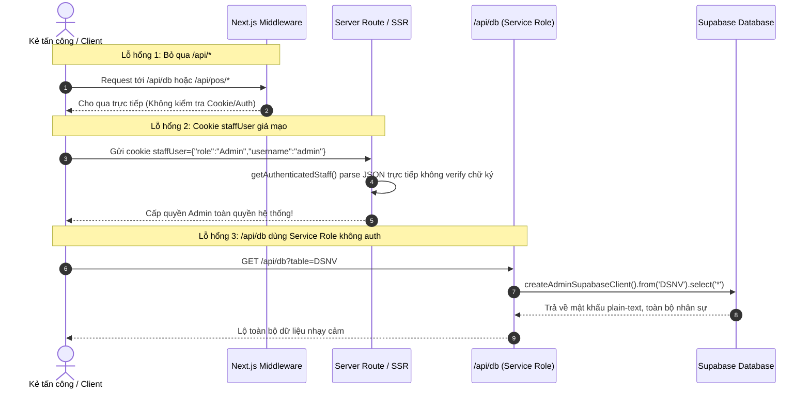
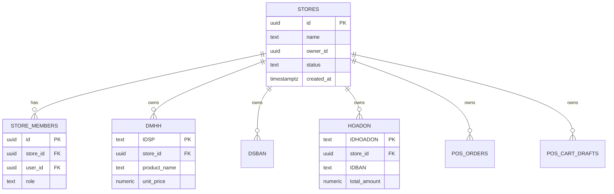
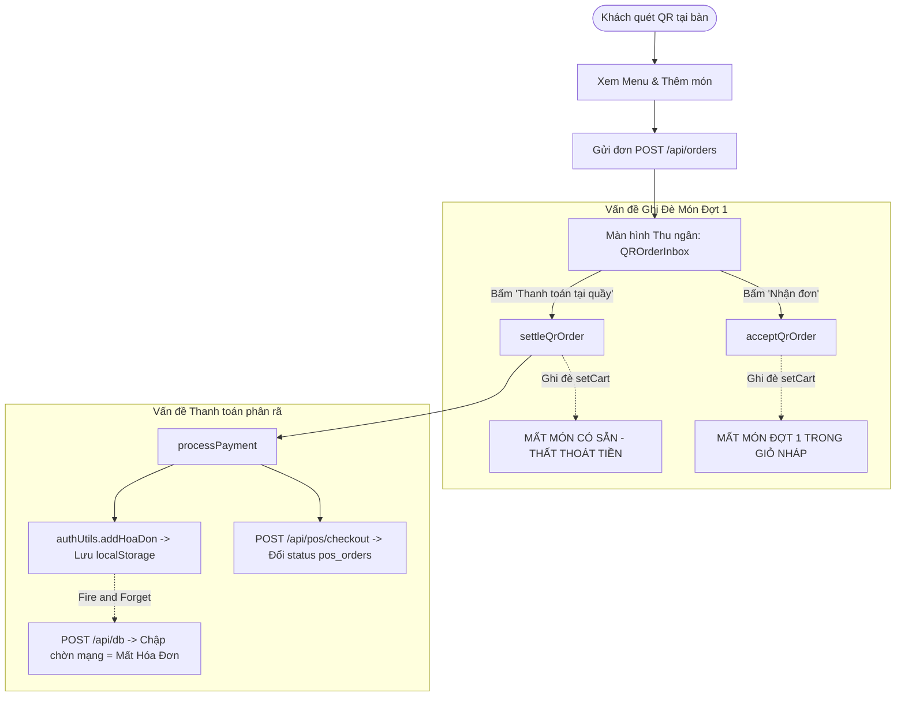
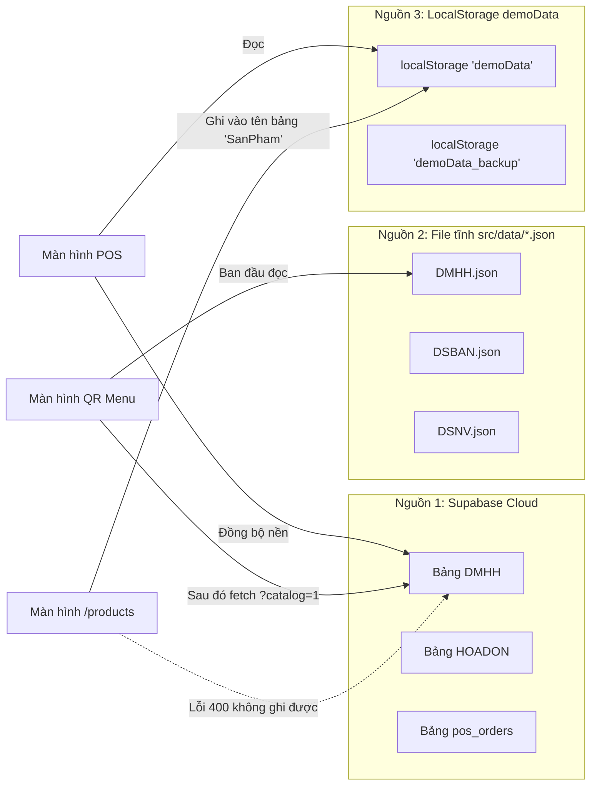

# BÁO CÁO KIỂM ĐỊNH KIẾN TRÚC HỆ THỐNG & LOGIC NGHIỆP VỤ POS
**Dự án:** Hệ thống POS & Gọi món Quán Trà Sữa H2MilkTea  
**Người thực hiện:** Agent 1 – Kiến trúc sư Hệ thống & Kiểm định Logic Nghiệp vụ POS  
**Chế độ thực thi:** READ-ONLY AUDIT (Tuyệt đối không sửa code)  
**Thời gian lập báo cáo:** 30/10/2026  

---

## MỤC LỤC
1. [Hạng mục 1: Phân tách dữ liệu & Phân quyền (Multi-tenancy vs Staff RBAC)](#1-hạng-mục-1-bài-toán-phân-tách-dữ-liệu-theo-tài-khoản--cửa-hàng)
   - [Trường hợp A: Phân quyền nội bộ 1 quán (Staff RBAC)](#trường-hợp-a-nội-bộ-1-quán-h2milktea-lỗ-hổng-staff-rbac)
   - [Trường hợp B: Mở rộng thị trường Multi-tenant SaaS](#trường-hợp-b-mở-rộng-đưa-ra-thị-trường--nhiều-cửa-hàng-độc-lập-multi-tenant-saas)
2. [Hạng mục 2: Kiểm định luồng nghiệp vụ đặc thù quán H2MilkTea](#2-hạng-mục-2-kiểm-định-luồng-nghiệp-vụ-đặc-thù-quán-h2milktea)
   - [Luồng Gọi thêm món / Gộp đơn QR tại bàn](#21-luồng-gọi-thêm-món--gộp-đơn-qr-tại-bàn-nguy-cơ-mất-món-thất-thoát-doanh-thu)
   - [Luồng Chuyển bàn, Xóa giỏ hàng & Đồng bộ giỏ nháp](#22-luồng-chuyển-bàn-xóa-giỏ-hàng-và-đồng-bộ-giỏ-nháp-đa-thiết-bị)
   - [Luồng Thanh toán: Bất đối xứng Client - Server](#23-luồng-thanh-toán-bất-đối-xứng-client---server-và-rủi-ro-mạng-chập-chờn)
3. [Hạng mục 3: Kiểm định tính đồng nhất nguồn dữ liệu (Data Source Consistency)](#3-hạng-mục-3-kiểm-định-tính-đồng-nhất-của-nguồn-dữ-liệu-data-source-consistency)
   - [Xung đột tam giác dữ liệu: Supabase vs File JSON vs localStorage](#31-xung-đột-tam-giác-dữ-liệu-supabase-cloud-vs-file-json-vs-localstorage)
   - [Danh sách màn hình bị lệch nguồn dữ liệu](#32-danh-sách-màn-hình-bị-lệch-nguồn-dữ-liệu-khiến-sửa-giá-không-cập-nhật)
4. [Hạng mục 4: Bảng kế hoạch khắc phục ưu tiên (Action Plan)](#4-hạng-mục-4-bảng-kế-hoạch-khắc-phục-ưu-tiên-action-plan)

---

## 1. HẠNG MỤC 1: BÀI TOÁN PHÂN TÁCH DỮ LIỆU THEO TÀI KHOẢN / CỬA HÀNG

### TRƯỜNG HỢP A: NỘI BỘ 1 QUÁN H2MILKTEA (LỖ HỔNG STAFF RBAC)
Hiện tại, khi chủ quán tạo tài khoản cho Nhân viên thu ngân / Pha chế trong bảng `DSNV`, các tài khoản này dùng chung cơ sở dữ liệu. Tuy nhiên, hệ thống đang tồn tại **lỗ hổng leo thang đặc quyền (Privilege Escalation) và bypass xác thực ở mức độ P0**.



#### Chi tiết các phát hiện:

#### [P0-SEC-01] Giả mạo phiên Admin qua cookie `staffUser` không có chữ ký số
- **Vị trí code:** 
  - [src/lib/supabase/server.ts#L40-L65](file:///C:/Users/Gaming/.gemini/antigravity/worktrees/H2MilkTea/audit_pos_architecture_report/src/lib/supabase/server.ts#L40-L65)
  - [src/lib/supabase/server.ts#L86-L94](file:///C:/Users/Gaming/.gemini/antigravity/worktrees/H2MilkTea/audit_pos_architecture_report/src/lib/supabase/server.ts#L86-L94)
  - [src/utils/authUtils.ts#L1394-L1410](file:///C:/Users/Gaming/.gemini/antigravity/worktrees/H2MilkTea/audit_pos_architecture_report/src/utils/authUtils.ts#L1394-L1410)
- **Mức độ:** **P0 (Critical)**
- **Hiện trạng:**
  - Trong `src/utils/authUtils.ts` dòng 1394-1409, khi đăng nhập, hệ thống sinh token ngẫu nhiên: `const token = 'Bearer ' + Math.random().toString(36).substring(7);` và ghi cookie dạng JSON trần:
    ```ts
    const staffUserCookie = `staffUser=${encodeURIComponent(JSON.stringify({
        username: userData.username || 'staff',
        name: userData['Họ và Tên'] || userData.username || 'Thu ngân',
        role: userData['Vai trò'] || userData['Phân quyền'] || 'Thu ngân',
        email: userData.Email || userData.email || '',
    }))}; ...`;
    ```
  - Tại backend [src/lib/supabase/server.ts#L40-L65](file:///C:/Users/Gaming/.gemini/antigravity/worktrees/H2MilkTea/audit_pos_architecture_report/src/lib/supabase/server.ts#L40-L65), hàm `getAuthenticatedStaff` kiểm tra Supabase Auth trước, nhưng lại có **fallback tin tưởng tuyệt đối cookie `staffUser`**:
    ```ts
    const staffCookie = cookiePairs.find((c) => c.name === 'staffUser');
    if (staffCookie && staffCookie.value) {
      const staffInfo = JSON.parse(staffCookie.value);
      return { id: ..., user_metadata: { role: staffInfo.role, username: staffInfo.username } };
    }
    ```
  - Tiếp tục tại dòng 86-94, `getStaffRole` xét quyền Admin chỉ dựa vào việc `username === 'admin'` hoặc `role === 'Admin'`.
- **Rủi ro:** Bất kỳ ai (kể cả khách vãng lai hoặc nhân viên thu ngân bị hạn chế quyền) chỉ cần mở DevTools Console gõ:
  ```javascript
  document.cookie = "staffUser=" + encodeURIComponent(JSON.stringify({username: "admin", role: "Admin", email: "admin@h2.com"})) + "; path=/";
  ```
  Ngay lập tức toàn bộ các API Server-side xác nhận tài khoản này là **Admin tối cao**, có quyền truy cập báo cáo tài chính, xóa dữ liệu kế toán, và đổi cài đặt hệ thống.
- **Giải pháp đề xuất:** 
  1. Xóa bỏ hoàn toàn fallback đọc role từ cookie plain-text `staffUser` và `authToken`.
  2. Bắt buộc 100% phiên đăng nhập phải xác thực thông qua JWT của Supabase Auth (`@supabase/ssr` `createClient().auth.getUser()`).
  3. Phân quyền Admin/Thu ngân/Pha chế phải được lưu trong JWT `app_metadata` của Supabase Auth hoặc truy vấn từ bảng `DSNV` bằng `auth.uid()` được xác thực máy chủ.

---

#### [P0-SEC-02] Middleware bỏ qua hoàn toàn kiểm tra xác thực cho tất cả API routes `/api/*`
- **Vị trí code:** [src/middleware.ts#L12-L21](file:///C:/Users/Gaming/.gemini/antigravity/worktrees/H2MilkTea/audit_pos_architecture_report/src/middleware.ts#L12-L21)
- **Mức độ:** **P0 (Critical)**
- **Hiện trạng:**
  - `src/middleware.ts` có đoạn mã:
    ```ts
    // Đối với các API endpoints: chuyển tiếp với correlation-id và bỏ qua route check UI
    if (pathname.startsWith('/api')) {
      const response = NextResponse.next({ request: { headers: requestHeaders } });
      response.headers.set('x-correlation-id', correlationId);
      return response;
    }
    ```
  - Trong khi đó, việc kiểm tra đăng nhập (`authToken`) chỉ nằm ở dòng 110-119 dành riêng cho UI routes.
- **Rủi ro:** Toàn bộ các API phía sau (bao gồm cả các API thao tác dữ liệu nhạy cảm) không được bảo vệ ở tầng Gateway/Middleware. Bất kỳ request nào từ bên ngoài đều có thể chạm tới Route Handler.

---

#### [P0-SEC-03] API `/api/db` dùng Supabase Service Role Key nhưng không có bất kỳ bước kiểm tra quyền (Unauthenticated DB Tunnel)
- **Vị trí code:** 
  - [src/app/api/db/route.ts#L139-L163](file:///C:/Users/Gaming/.gemini/antigravity/worktrees/H2MilkTea/audit_pos_architecture_report/src/app/api/db/route.ts#L139-L163) (GET)
  - [src/app/api/db/route.ts#L166-L239](file:///C:/Users/Gaming/.gemini/antigravity/worktrees/H2MilkTea/audit_pos_architecture_report/src/app/api/db/route.ts#L166-L239) (POST)
- **Mức độ:** **P0 (Critical)**
- **Hiện trạng:**
  - Route `/api/db` được tạo ra để frontend gọi các thao tác `create, update, delete, getall` nhằm bypass RLS (`createAdminSupabaseClient()`).
  - Cả hàm `GET` lẫn `POST` **không gọi `getAuthenticatedStaff`** và không có bất kỳ cơ chế kiểm tra token/session nào!
- **Rủi ro:** 
  - Kẻ tấn công bên ngoài có thể gửi `GET /api/db?table=DSNV` và nhận về toàn bộ danh sách nhân viên bao gồm cột `password` (mật khẩu chưa mã hóa), `Email`, `Số điện thoại`.
  - Kẻ tấn công có thể gửi `POST /api/db` với payload `action: "delete", table: "HOADON"` để xóa sạch toàn bộ hóa đơn doanh thu của quán với quyền Service Role tối cao.
- **Giải pháp đề xuất:** 
  1. Thêm ngay `const staff = await getAuthenticatedStaff(request.headers.get('cookie') || ''); if (!staff) return NextResponse.json({error: 'Unauthorized'}, {status: 401});`.
  2. Tuyệt đối không cho phép query trực tiếp bảng `DSNV` qua `/api/db`.
  3. Kiểm tra vai trò: chỉ `isAdmin` mới được phép thao tác các bảng cấu hình, kho hàng, và xóa dữ liệu.

---

### TRƯỜNG HỢP B: MỞ RỘNG ĐƯA RA THỊ TRƯỜNG / NHIỀU CỬA HÀNG ĐỘC LẬP (MULTI-TENANT SAAS)

Khi mở rộng hệ thống H2MilkTea thành dịch vụ SaaS cho nhiều chủ quán trà sữa khác nhau thuê dùng độc lập:

#### 1. Thiết kế kiến trúc tối ưu trên Supabase:
Không tạo Project Supabase vật lý riêng cho từng quán (vì chi phí infra cao, khó bảo trì migration). Áp dụng mô hình **Shared Database, Shared Schema, Row-Level Isolation** kết hợp Supabase RLS.



#### 2. DDL Schema & Chính sách RLS chuẩn:
```sql
-- 1. Bảng quản lý cửa hàng (Tenants)
create table if not exists public.stores (
  id uuid primary key default gen_random_uuid(),
  name text not null,
  owner_id uuid references auth.users(id) on delete restrict,
  is_active boolean default true,
  created_at timestamptz default now()
);

-- 2. Bảng liên kết thành viên / nhân viên với cửa hàng
create table if not exists public.store_members (
  id uuid primary key default gen_random_uuid(),
  store_id uuid not null references public.stores(id) on delete cascade,
  user_id uuid not null references auth.users(id) on delete cascade,
  role text not null check (role in ('owner', 'manager', 'cashier', 'kitchen')),
  created_at timestamptz default now(),
  unique (store_id, user_id)
);

-- 3. Bổ sung cột store_id vào tất cả các bảng nghiệp vụ
alter table public."DMHH" add column if not exists store_id uuid references public.stores(id);
alter table public."DSBAN" add column if not exists store_id uuid references public.stores(id);
alter table public."HOADON" add column if not exists store_id uuid references public.stores(id);
alter table public."HOADONDETAIL" add column if not exists store_id uuid references public.stores(id);
alter table public.pos_orders add column if not exists store_id uuid references public.stores(id);
alter table public.pos_cart_drafts add column if not exists store_id uuid references public.stores(id);

-- 4. Hàm helper kiểm tra quyền truy cập Tenant tối ưu hiệu năng (Security Definer)
create or replace function public.has_store_access(p_store_id uuid, p_required_role text default null)
returns boolean
language sql
security definer
stable
as $$
  select exists (
    select 1 
    from public.store_members sm
    where sm.store_id = p_store_id
      and sm.user_id = auth.uid()
      and (
        p_required_role is null 
        or sm.role = p_required_role 
        or sm.role in ('owner', 'manager')
      )
  );
$$;

-- 5. Kích hoạt và áp dụng Row Level Security mẫu cho bảng HOADON
alter table public."HOADON" enable row level security;

create policy "Tenant isolation for HOADON select" on public."HOADON"
  for select to authenticated
  using (has_store_access(store_id));

create policy "Tenant isolation for HOADON insert" on public."HOADON"
  for insert to authenticated
  with check (has_store_access(store_id));
```

#### 3. Đánh giá chi phí công sức (Effort & Feasibility Evaluation):
- **Nếu triển khai ngay trong đồ án hiện tại:**
  - *Độ phức tạp:* **Rất cao (40 - 60 giờ làm việc)**.
  - *Rủi ro:* Cần sửa lại toàn bộ hơn 20 file API routes, hook, repository; sửa lại dữ liệu mẫu JSON; sửa toàn bộ câu lệnh RPC và `authUtils`. Nguy cơ gây lỗi dây chuyền (regression) làm hỏng buổi demo đồ án là rất lớn.
- **Khuyến nghị chiến lược:**
  - Trong phạm vi đồ án tốt nghiệp hiện tại: Giữ mô hình **Single-tenant (1 quán H2MilkTea)**, tập trung vá triệt để lỗ hổng xác thực Staff RBAC nội bộ (JWT chuẩn, bỏ cookie giả, vá `/api/db`).
  - Đưa toàn bộ bản thiết kế Multi-tenant SaaS (DDL, ERD, RLS function, và sơ đồ phân quyền Tenant) vào chương **"Kiến trúc mở rộng & Hướng phát triển tương lai"** của báo cáo đồ án. Cách làm này vừa giúp đồ án đạt điểm xuất sắc về tư duy kiến trúc hệ thống, vừa đảm bảo an toàn 100% cho mã nguồn chạy demo.

---

## 2. HẠNG MỤC 2: KIỂM ĐỊNH LUỒNG NGHIỆP VỤ ĐẶC THÙ QUÁN H2MILKTEA
*(Luồng: Khách quét QR -> Thu ngân nhận đơn / Pha chế -> Ngồi uống -> Gọi thêm món / Đổi bàn -> Thanh toán trả sau tại quầy)*



### 2.1. LUỒNG GỌI THÊM MÓN / GỘP ĐƠN QR TẠI BÀN (NGUY CƠ MẤT MÓN & THẤT THOÁT DOANH THU)

#### [P0-BIZ-01] `settleQrOrder` và `acceptQrOrder` ghi đè hoàn toàn giỏ hàng của bàn, xóa sạch các món đã gọi trước đó
- **Vị trí code:** 
  - [src/app/(dashboard)/pos/hooks/usePOS.ts#L612-L637](file:///C:/Users/Gaming/.gemini/antigravity/worktrees/H2MilkTea/audit_pos_architecture_report/src/app/(dashboard)/pos/hooks/usePOS.ts#L612-L637) (`settleQrOrder`)
  - [src/app/(dashboard)/pos/hooks/usePOS.ts#L640-L677](file:///C:/Users/Gaming/.gemini/antigravity/worktrees/H2MilkTea/audit_pos_architecture_report/src/app/(dashboard)/pos/hooks/usePOS.ts#L640-L677) (`acceptQrOrder`)
- **Mức độ:** **P0 (Critical - Sai lệch nghiệp vụ cốt lõi & Mất tiền)**
- **Phân tích chi tiết mã nguồn:**
  - Tại dòng 618-636 trong `settleQrOrder`:
    ```ts
    setSelectedTableId(order.table_id);
    setCart(order.items.map((item) => { ... }));
    setActivePOSOrderIds([order.id]);
    setSelectedCustomer(null);
    setShowCheckoutModal(true);
    ```
  - Tại dòng 662-663 trong `acceptQrOrder`:
    ```ts
    setCart(convertedItems);
    setActiveOrders((prev) => new Map(prev).set(order.table_id, convertedItems));
    ```
- **Kịch bản lỗi thực tế:**
  1. Khách ngồi Bàn 3 gọi đợt 1 gồm 2 Ly Trà Sữa Trân Châu (Đơn QR #101). Thu ngân bấm "Nhận đơn" -> Giỏ hàng Bàn 3 có 2 ly trà sữa, bếp pha chế xong, khách đang ngồi uống.
  2. 20 phút sau, khách quét QR gọi thêm đợt 2 gồm 1 Phần Hướng Dương (Đơn QR #102).
  3. Thu ngân thấy thông báo, bấm "Thanh toán tại quầy" trên đơn #102:
     - `settleQrOrder` chạy: `setCart` bị ghi đè chỉ còn duy nhất 1 Phần Hướng Dương!
     - `activePOSOrderIds` chỉ lưu `[#102]`.
     - **Kết quả:** Modal thanh toán mở ra với tổng tiền chỉ tính 1 đĩa hướng dương (15.000đ). Hai ly trà sữa đợt 1 (60.000đ) bị xóa sổ khỏi giỏ hàng! Khách thanh toán 15.000đ và rời bàn -> **Quán bị thất thoát 60.000đ**.
     - Đơn #101 trong `pos_orders` vẫn ở trạng thái `payment_status = 'unpaid'` vĩnh viễn trên cơ sở dữ liệu.
  4. Tương tự, nếu khách gọi thêm đợt 2 mà thu ngân bấm "Nhận đơn", `acceptQrOrder` cũng đè giỏ hàng nháp bàn 3 thành đợt 2, làm mất sạch đợt 1.
- **Nghịch lý mã nguồn:** Trong dự án đã có sẵn file [src/lib/cart/mergeCart.ts](file:///C:/Users/Gaming/.gemini/antigravity/worktrees/H2MilkTea/audit_pos_architecture_report/src/lib/cart/mergeCart.ts) với 2 hàm `diffCartItems` và `resolveCartConflict` hoàn chỉnh, nhưng cả `settleQrOrder` lẫn `acceptQrOrder` đều không hề import hay sử dụng!
- **Giải pháp đề xuất:**
  - Trong `acceptQrOrder`: Khi nhận đơn mới, lấy giỏ hiện tại của bàn đó (`activeOrders.get(order.table_id) || []`), gọi `resolveCartConflict(existingCart, convertedItems, 'merge_quantities')` rồi mới lưu vào state và sync lên `/api/pos/cart-draft`.
  - Trong `settleQrOrder`: Nếu bàn đã có món sẵn hoặc có nhiều đơn QR chưa thanh toán, phải gộp tất cả các đơn của bàn đó (`orderIds: [...allUnpaidOrderIds]`) và gộp toàn bộ danh sách món lại trước khi mở Checkout Modal.

---

### 2.2. LUỒNG CHUYỂN BÀN, XÓA GIỎ HÀNG VÀ ĐỒNG BỘ GIỎ NHÁP ĐA THIẾT BỊ

#### [P1-BIZ-02] Lệch pha giữa Client và Server khi Chuyển bàn (`transferTable`) gây đè mất món bàn đích
- **Vị trí code:** 
  - [src/app/(dashboard)/pos/hooks/usePOS.ts#L858-L861](file:///C:/Users/Gaming/.gemini/antigravity/worktrees/H2MilkTea/audit_pos_architecture_report/src/app/(dashboard)/pos/hooks/usePOS.ts#L858-L861)
  - [src/app/api/pos/transfer-table/route.ts#L63-L79](file:///C:/Users/Gaming/.gemini/antigravity/worktrees/H2MilkTea/audit_pos_architecture_report/src/app/api/pos/transfer-table/route.ts#L63-L79)
- **Mức độ:** **P1 (High)**
- **Hiện trạng:**
  - Trên Server (`/api/pos/transfer-table`), khi chuyển từ Bàn A sang Bàn B: Nếu Bàn B đã có giỏ hàng, server thực hiện gộp: `mergedCart = [...targetCart, ...sourceCart]`.
  - Nhưng tại Client trong `usePOS.ts` dòng 858-861:
    ```ts
    const newActiveOrders = new Map(activeOrders);
    newActiveOrders.set(targetTableId, [...cart]); // cart hiện tại của bàn nguồn A
    newActiveOrders.delete(sourceTableId);
    setActiveOrders(newActiveOrders);
    ```
  - Client không hề nhận bản `mergedCart` từ server mà tự ý gán đè giỏ hàng của Bàn A lên Bàn B!
  - Sau đó, cơ chế autosave của `useSharedCartDraft` (debounce 300ms) sẽ đẩy giỏ hàng bị ghi đè này ngược lên `/api/pos/cart-draft`, xóa sổ các món vốn có của Bàn B trên database.
- **Giải pháp đề xuất:** API `/api/pos/transfer-table` phải trả về `draft: mergedCart`, và client phải cập nhật state bằng dữ liệu trả về từ server thay vì tự gán.

---

#### [P1-BIZ-03] Hiện tượng "Giỏ hàng ma" (Ghost Cart Resurrection) khi xóa giỏ hàng giữa 2 thiết bị
- **Vị trí code:** [src/app/(dashboard)/pos/hooks/useSharedCartDraft.ts#L175-L182](file:///C:/Users/Gaming/.gemini/antigravity/worktrees/H2MilkTea/audit_pos_architecture_report/src/app/(dashboard)/pos/hooks/useSharedCartDraft.ts#L175-L182)
- **Mức độ:** **P1 (High)**
- **Hiện trạng:**
  - Trong `useSharedCartDraft.ts`:
    ```ts
    // Nếu thu ngân đã bấm món trong lúc tải bản nháp rỗng từ server, giữ lại và lưu lên server
    if (remoteCart.length === 0 && cartRef.current.length > 0) {
      setLastSyncAt(new Date());
      setStatus('connected');
      setConflictData(null);
      void saveMergedDraft(cartRef.current, customerRef.current, 0);
      return;
    }
    ```
- **Kịch bản lỗi (Ghost Cart):**
  1. Máy POS 1 và Máy POS 2 đều đang mở Bàn 5.
  2. Máy POS 1 bấm nút "Hủy / Xóa giỏ hàng" (`clearCart()`). Hàm `clearSharedCartDraft()` gửi request `DELETE /api/pos/cart-draft?tableId=BAN005` thành công, bảng `pos_cart_drafts` xóa dòng bàn 5.
  3. Máy POS 2 tại thời điểm đó vì lý do mạng chậm vài trăm mili-giây, hoặc đang chạy Polling `fetchDraft`:
     - Nhận về `draft = null` (hoặc `remoteCart = []`).
     - Đoạn code dòng 175-182 kích hoạt: Nó nghĩ rằng "Máy 2 vừa bấm món nhưng server lại rỗng", thế là nó tự động gọi `saveMergedDraft(cartRef.current, ..., 0)` để ĐẨY LẠI GIỎ HÀNG CŨ LÊN DATABASE!
  4. Bàn 5 vừa được Máy 1 xóa trắng thì 1 giây sau lại biến thành "Đang có món" (Giỏ hàng ma sống lại).
- **Giải pháp đề xuất:** Khi một thiết bị gọi `clearCart()`, phải phát đi sự kiện `FORCE_CLEAR` có kèm `timestamp` và `cleared_by`. Các thiết bị khác khi nhận được cờ này phải reset ngay `cartRef.current = []`, hủy toàn bộ debounce timer đang chờ ghi và không được kích hoạt logic "cứu giỏ".

---

### 2.3. LUỒNG THANH TOÁN: BẤT ĐỐI XỨNG CLIENT - SERVER VÀ RỦI RO MẠNG CHẬP CHỜN

#### [P0-BIZ-04] Thanh toán phân tán không nguyên tử (Non-atomic Checkout): pos_orders gọi API Server, còn HOADON/DETAIL gọi qua Client authUtils kiểu Fire-and-Forget
- **Vị trí code:** 
  - [src/app/(dashboard)/pos/hooks/usePOS.ts#L891-L919](file:///C:/Users/Gaming/.gemini/antigravity/worktrees/H2MilkTea/audit_pos_architecture_report/src/app/(dashboard)/pos/hooks/usePOS.ts#L891-L919) (`saveInvoice`)
  - [src/app/(dashboard)/pos/hooks/usePOS.ts#L1015-L1034](file:///C:/Users/Gaming/.gemini/antigravity/worktrees/H2MilkTea/audit_pos_architecture_report/src/app/(dashboard)/pos/hooks/usePOS.ts#L1015-L1034) (`processPayment`)
  - [src/utils/authUtils.ts#L962-L981](file:///C:/Users/Gaming/.gemini/antigravity/worktrees/H2MilkTea/audit_pos_architecture_report/src/utils/authUtils.ts#L962-L981) (`apiRequest`)
- **Mức độ:** **P0 (Critical)**
- **Phân tích rủi ro:**
  1. **Không nguyên tử (Lack of Atomicity):** Khi bấm Thanh toán:
     - Bước 1: Gửi request `POST /api/pos/checkout` đổi trạng thái `pos_orders` sang `paid`.
     - Bước 2: Gọi `authUtils.addHoaDon(invoice)` tạo hóa đơn chính.
     - Bước 3: Lặp `details.map` gửi N request riêng biệt gọi `authUtils.addHoaDonDetail(detail)`.
  2. **Rủi ro mạng chập chờn:**
     - Trong `authUtils.apiRequest` dòng 966-980: Thao tác ghi DB qua `/api/db` được gửi dưới dạng **Fire-and-forget** (`fetch('/api/db', ...).catch(...)`), hoàn toàn không `await` phản hồi từ DB thật! Hàm trả về thành công ngay khi vừa ghi vào `localStorage`.
     - Nếu mạng chập chờn, máy chủ chập chờn hoặc Supabase lỗi timeout: Đơn hàng hiển thị "Đã thanh toán thành công", hóa đơn lưu trong `localStorage` của trình duyệt thu ngân, nhưng **Supabase Cloud KHÔNG HỀ CÓ DỮ LIỆU HÓA ĐƠN**.
     - Nếu thu ngân đổi ca, xóa cache trình duyệt, hoặc mở máy khác kiểm tra báo cáo: Toàn bộ doanh thu của các hóa đơn này bị bốc hơi không dấu vết!
  3. **Rủi ro phân mảnh chi tiết:** Nếu mạng bị ngắt giữa chừng trong vòng lặp `Promise.all(detailPromises)`: Bảng `HOADON` có tổng tiền 100.000đ nhưng bảng `HOADONDETAIL` chỉ lưu được 1 món 30.000đ, 2 món còn lại bị mất -> Báo cáo bán hàng theo sản phẩm bị sai lệch hoàn toàn so với báo cáo doanh thu tổng.
  4. **Nghịch lý kiến trúc lớn nhất:**
     - Trong file migration [supabase/migrations/202610180004_pos_core_rpc.sql](file:///C:/Users/Gaming/.gemini/antigravity/worktrees/H2MilkTea/audit_pos_architecture_report/supabase/migrations/202610180004_pos_core_rpc.sql), tác giả dự án đã viết sẵn Stored Procedure `public.pos_pay_order(payload jsonb)`:
       - Có transaction nguyên tử `BEGIN ... COMMIT`.
       - Có khóa chống thanh toán lặp `idempotency_key`.
       - Khóa dòng bảng bàn `DSBAN ... FOR UPDATE` chống race condition.
       - Insert `HOADON` + insert toàn bộ `HOADONDETAIL` + cập nhật bàn về `Trống` + xóa `pos_cart_drafts` + đổi trạng thái `pos_orders` sang `paid` chỉ trong **1 round-trip duy nhất**!
     - Thế nhưng, Client trong `usePOS.ts` lại **hoàn toàn bỏ qua hàm RPC chuẩn mực này**, đi thực hiện một chuỗi thao tác rời rạc qua client!
- **Giải pháp đề xuất:** Thay thế toàn bộ đoạn code từ dòng 1015 đến 1034 trong `usePOS.ts` bằng việc gọi duy nhất 1 API Server `/api/pos/pay-order` (API này sẽ gọi RPC `pos_pay_order`).

---

## 3. HẠNG MỤC 3: KIỂM ĐỊNH TÍNH ĐỒNG NHẤT CỦA NGUỒN DỮ LIỆU (DATA SOURCE CONSISTENCY)

### 3.1. XUNG ĐỘT TAM GIÁC DỮ LIỆU: SUPABASE CLOUD VS FILE JSON VS LOCALSTORAGE

Hệ thống hiện tại đang duy trì cùng lúc 3 nguồn dữ liệu không có cơ chế đồng bộ nhất quán:



1. **Supabase Cloud:** Đóng vai trò CSDL thật trên cloud, nhưng không được cập nhật đầy đủ do các thao tác ghi bị nuốt lỗi hoặc gọi sai tên bảng.
2. **File tĩnh `src/data/*.json`:** Chứa dữ liệu đóng băng từ lúc build dự án. Nhiều component vẫn import trực tiếp file này làm giá trị khởi tạo hoặc dữ liệu fallback.
3. **Bộ nhớ đệm `localStorage` (`demoData`):** Nằm cục bộ trên từng trình duyệt. Khi một máy sửa giá, chỉ `localStorage` của máy đó nhận, các máy khác và điện thoại khách hàng quét QR hoàn toàn không biết.

---

### 3.2. DANH SÁCH MÀN HÌNH BỊ LỆCH NGUỒN DỮ LIỆU KHIẾN SỬA GIÁ KHÔNG CẬP NHẬT

#### [P1-DATA-01] Màn hình Quản lý Sản phẩm (`/products`) dùng sai tên bảng `SanPham` thay vì `DMHH`
- **Vị trí code:** 
  - [src/app/(dashboard)/products/hooks/useProducts.ts#L20](file:///C:/Users/Gaming/.gemini/antigravity/worktrees/H2MilkTea/audit_pos_architecture_report/src/app/(dashboard)/products/hooks/useProducts.ts#L20) (`apiRequest('SanPham', 'Find')`)
  - [src/app/(dashboard)/products/hooks/useProducts.ts#L61](file:///C:/Users/Gaming/.gemini/antigravity/worktrees/H2MilkTea/audit_pos_architecture_report/src/app/(dashboard)/products/hooks/useProducts.ts#L61) (`apiRequest('SanPham', 'Add')`)
  - [src/app/(dashboard)/products/hooks/useProducts.ts#L76](file:///C:/Users/Gaming/.gemini/antigravity/worktrees/H2MilkTea/audit_pos_architecture_report/src/app/(dashboard)/products/hooks/useProducts.ts#L76) (`apiRequest('SanPham', 'Edit')`)
  - [src/app/api/db/route.ts#L12-L107](file:///C:/Users/Gaming/.gemini/antigravity/worktrees/H2MilkTea/audit_pos_architecture_report/src/app/api/db/route.ts#L12-L107) (`SCHEMAS`)
- **Mức độ:** **P1 (High)**
- **Hiện tượng:**
  - Bảng sản phẩm chính thức trên Supabase và trong schema của `/api/db` được đặt tên là `DMHH` (Danh mục hàng hóa).
  - Tuy nhiên, hook của trang Sản phẩm `src/app/(dashboard)/products/hooks/useProducts.ts` lại gọi `authUtils.apiRequest('SanPham', ...)`.
  - Khi `apiRequest` gửi POST lên `/api/db`, do `SCHEMAS['SanPham']` không tồn tại, `/api/db` trả về lỗi:
    `{ success: false, error: "Tên bảng không hợp lệ hoặc không được phép" }` (HTTP 400).
  - Lỗi này bị `catch` âm thầm tại `authUtils.ts#L976`.
  - Kết quả: Thao tác sửa giá chỉ được lưu vào `this.demoData['SanPham']` trong localStorage của máy người quản trị. Bảng `DMHH` trên Supabase không đổi.
  - Khi nhân viên thu ngân mở màn hình POS (`/pos`) hoặc khách hàng quét QR (`/order/menu`), các màn hình này đọc từ `DMHH` nên vẫn hiển thị **giá cũ**!
- **Giải pháp đề xuất:** Chuẩn hóa toàn bộ tên bảng trong `src/app/(dashboard)/products/hooks/useProducts.ts` thành `DMHH`, hoặc xóa bỏ trang cũ `/products` và chuyển hướng sang `/menu/products` (nơi đã dùng `getAllSanPham` map đúng vào `DMHH`).

---

#### [P1-DATA-02] Menu Khách đặt QR (`/order/menu`) nạp menu tĩnh từ `DMHH.json` gây hiện tượng chớp đổi giá (Layout/Price Flashing)
- **Vị trí code:** 
  - [src/app/order/menu/page.tsx#L21](file:///C:/Users/Gaming/.gemini/antigravity/worktrees/H2MilkTea/audit_pos_architecture_report/src/app/order/menu/page.tsx#L21) (`import menuData from '@/data/DMHH.json'`)
  - [src/app/order/menu/page.tsx#L34-L36](file:///C:/Users/Gaming/.gemini/antigravity/worktrees/H2MilkTea/audit_pos_architecture_report/src/app/order/menu/page.tsx#L34-L36) (`useState(menuData)`)
  - [src/app/order/menu/page.tsx#L154-L169](file:///C:/Users/Gaming/.gemini/antigravity/worktrees/H2MilkTea/audit_pos_architecture_report/src/app/order/menu/page.tsx#L154-L169) (`useEffect fetch /api/orders?catalog=1`)
- **Mức độ:** **P1 (High)**
- **Hiện tượng:**
  - Khách quét mã QR mở menu trên điện thoại: Trang render tức thì với giá của file `DMHH.json` (ví dụ: Trà sữa nướng giá 25.000đ).
  - 1-2 giây sau, `useEffect` chạy xong API `/api/orders?catalog=1` lấy từ Supabase (quán đã tăng giá lên 30.000đ), giá trên màn hình bị nhảy từ 25.000đ lên 30.000đ ngay trước mắt khách hàng.
  - Nếu khách bấm đặt hàng nhanh trong 1 giây đầu tiên, đơn hàng có thể bị gửi đi với giá cũ nếu API server không kiểm tra lại giá gốc từ DB.
- **Giải pháp đề xuất:** Sử dụng Server Component hoặc React Query với SSR hydration cho `/order/menu` để lấy dữ liệu `DMHH` mới nhất từ Supabase ngay từ lần render đầu tiên, không dùng JSON tĩnh làm initial state cho client state.

---

#### [P2-DATA-03] AI Chatbot và Đặt đơn dùng dữ liệu bàn từ `DSBAN.json` tĩnh
- **Vị trí code:** 
  - [src/app/api/ai/chat/route.ts#L2-L3](file:///C:/Users/Gaming/.gemini/antigravity/worktrees/H2MilkTea/audit_pos_architecture_report/src/app/api/ai/chat/route.ts#L2-L3)
  - [src/app/api/customer-order/validate-table/route.ts#L2](file:///C:/Users/Gaming/.gemini/antigravity/worktrees/H2MilkTea/audit_pos_architecture_report/src/app/api/customer-order/validate-table/route.ts#L2)
- **Mức độ:** **P2 (Medium)**
- **Hiện trạng:** Các API AI và kiểm tra hợp lệ của bàn import trực tiếp file `DSBAN.json`. Nếu quán thêm bàn mới (ví dụ: Bàn 15, Bàn 16) trên giao diện Quản lý bàn (`/tables`), AI Chatbot và API validate bàn sẽ báo bàn không tồn tại vì file JSON tĩnh không tự cập nhật.

---

## 4. HẠNG MỤC 4: BẢNG KẾ HOẠCH KHẮC PHỤC ƯU TIÊN (ACTION PLAN)

Dưới đây là bảng tổng hợp các đầu việc khắc phục được phân cấp độ ưu tiên (P0: Cực kỳ khẩn cấp, P1: Quan trọng, P2: Cải tiến dài hạn).  
> [!IMPORTANT]
> Đây là bản đề xuất kế hoạch để xem xét và duyệt trước. Theo đúng chỉ thị của chế độ READ-ONLY AUDIT, tôi **chưa thực hiện bất kỳ thay đổi nào vào mã nguồn**.

| Mức độ | Mã lỗi | File & Dòng Code | Hiện tượng & Rủi ro | Giải pháp kỹ thuật đề xuất | Độ phức tạp |
| :---: | :---: | :--- | :--- | :--- | :---: |
| **P0** | **P0-SEC-01** | [src/lib/supabase/server.ts#L40-L65](file:///C:/Users/Gaming/.gemini/antigravity/worktrees/H2MilkTea/audit_pos_architecture_report/src/lib/supabase/server.ts#L40-L65)<br>[src/utils/authUtils.ts#L1403](file:///C:/Users/Gaming/.gemini/antigravity/worktrees/H2MilkTea/audit_pos_architecture_report/src/utils/authUtils.ts#L1403) | Giả mạo quyền Admin dễ dàng bằng cách set cookie `staffUser` plain-text. | Xóa bỏ fallback cookie plain-text; chỉ cấp quyền dựa trên Supabase Auth JWT đã được verify. | 2 giờ |
| **P0** | **P0-SEC-03** | [src/app/api/db/route.ts#L139-L239](file:///C:/Users/Gaming/.gemini/antigravity/worktrees/H2MilkTea/audit_pos_architecture_report/src/app/api/db/route.ts#L139-L239) | `/api/db` dùng Service Role Key nhưng không kiểm tra xác thực, lộ toàn bộ mật khẩu DSNV và cho phép xóa HOADON từ bên ngoài. | Bổ sung kiểm tra `getAuthenticatedStaff`, chặn truy cập bảng `DSNV`, chỉ cho Admin thực hiện thao tác nhạy cảm. | 1.5 giờ |
| **P0** | **P0-BIZ-01** | [src/app/(dashboard)/pos/hooks/usePOS.ts#L612-L677](file:///C:/Users/Gaming/.gemini/antigravity/worktrees/H2MilkTea/audit_pos_architecture_report/src/app/(dashboard)/pos/hooks/usePOS.ts#L612-L677) | `settleQrOrder` và `acceptQrOrder` dùng `setCart` ghi đè toàn bộ món đợt 1 khi khách gọi thêm đợt 2, gây thất thoát tiền bill. | Sử dụng `resolveCartConflict(existingCart, newItems, 'merge_quantities')` từ `mergeCart.ts` để gộp bảo toàn món. | 2.5 giờ |
| **P0** | **P0-BIZ-04** | [src/app/(dashboard)/pos/hooks/usePOS.ts#L891-L1034](file:///C:/Users/Gaming/.gemini/antigravity/worktrees/H2MilkTea/audit_pos_architecture_report/src/app/(dashboard)/pos/hooks/usePOS.ts#L891-L1034) | Luồng thanh toán phân tán: gọi `/api/pos/checkout` xong lưu hóa đơn bằng `authUtils.addHoaDon` (fire-and-forget qua `/api/db`). Mất hóa đơn nếu mạng chập chờn. | Chuyển sang gọi RPC `pos_pay_order` (đã có sẵn trong CSDL) qua một API Server duy nhất, đảm bảo tính nguyên tử 100%. | 3 giờ |
| **P1** | **P1-DATA-01** | [src/app/(dashboard)/products/hooks/useProducts.ts#L20-L76](file:///C:/Users/Gaming/.gemini/antigravity/worktrees/H2MilkTea/audit_pos_architecture_report/src/app/(dashboard)/products/hooks/useProducts.ts#L20-L76) | Trang `/products` gọi bảng `SanPham`, bị `/api/db` từ chối, chỉ lưu cục bộ localStorage, màn hình POS không cập nhật giá mới. | Đổi tên bảng thành `DMHH` khớp với schema CSDL hoặc redirect trang `/products` sang `/menu/products`. | 1 giờ |
| **P1** | **P1-BIZ-02** | [src/app/(dashboard)/pos/hooks/usePOS.ts#L858-L861](file:///C:/Users/Gaming/.gemini/antigravity/worktrees/H2MilkTea/audit_pos_architecture_report/src/app/(dashboard)/pos/hooks/usePOS.ts#L858-L861) | Khi chuyển bàn, client tự gán đè giỏ nguồn vào giỏ đích, làm mất món sẵn có ở bàn đích trước khi server gộp. | Cập nhật state client bằng giỏ hàng gộp `mergedCart` do server trả về sau khi chuyển bàn. | 1.5 giờ |
| **P1** | **P1-BIZ-03** | [src/app/(dashboard)/pos/hooks/useSharedCartDraft.ts#L175-L182](file:///C:/Users/Gaming/.gemini/antigravity/worktrees/H2MilkTea/audit_pos_architecture_report/src/app/(dashboard)/pos/hooks/useSharedCartDraft.ts#L175-L182) | Hiện tượng "Giỏ hàng ma": Máy A bấm xóa bàn nhưng Máy B tự động "cứu giỏ" đẩy ngược dữ liệu cũ lên CSDL. | Thiết lập cơ chế `FORCE_CLEAR` có cờ kiểm soát để hủy bỏ mọi hoạt động autosave khi bàn bị xóa. | 2 giờ |
| **P1** | **P1-DATA-02** | [src/app/order/menu/page.tsx#L34-L36](file:///C:/Users/Gaming/.gemini/antigravity/worktrees/H2MilkTea/audit_pos_architecture_report/src/app/order/menu/page.tsx#L34-L36) | Màn hình QR Menu dùng initial state từ file JSON tĩnh gây hiện tượng giật nhảy giá khi API tải xong. | Hydrate dữ liệu menu từ Supabase ngay trên Server Component hoặc hiển thị Skeleton loading chuẩn. | 2 giờ |
| **P2** | **P2-SEC-02** | [src/middleware.ts#L12-L21](file:///C:/Users/Gaming/.gemini/antigravity/worktrees/H2MilkTea/audit_pos_architecture_report/src/middleware.ts#L12-L21) | Middleware bypass toàn bộ các route `/api/*`. | Xây dựng middleware xác thực token chung cho các API nội bộ `/api/pos/*`, `/api/admin/*`. | 2 giờ |
| **P2** | **P2-DATA-03** | [src/app/api/ai/chat/route.ts#L2](file:///C:/Users/Gaming/.gemini/antigravity/worktrees/H2MilkTea/audit_pos_architecture_report/src/app/api/ai/chat/route.ts#L2) | Các API AI Chatbot đọc dữ liệu bàn và món ăn từ file tĩnh JSON thay vì Supabase. | Chuyển sang đọc qua Supabase Client với cache revalidation (ISR / Tag revalidation). | 1.5 giờ |
| **P2** | **P2-ARCH-01** | [docs/audit-agent-1-logic-and-architecture.md](#trường-hợp-b-mở-rộng-đưa-ra-thị-trường--nhiều-cửa-hàng-độc-lập-multi-tenant-saas) | Kiến trúc Multi-tenancy cho mô hình chuỗi quán / SaaS thương mại. | Đưa bản thiết kế DDL, ERD và RLS policies vào chương "Kiến trúc mở rộng" của báo cáo đồ án. | 3 giờ (Viết báo cáo) |

---
*Báo cáo được lập hoàn tất bởi Agent 1. Mã nguồn hiện tại được giữ nguyên vẹn 100%.*
